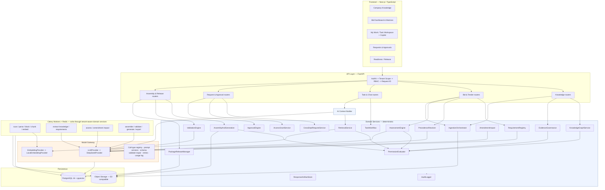
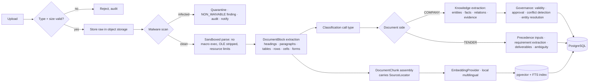
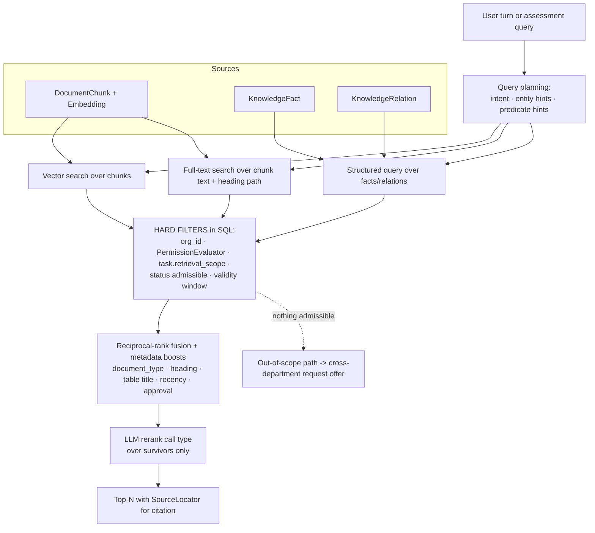
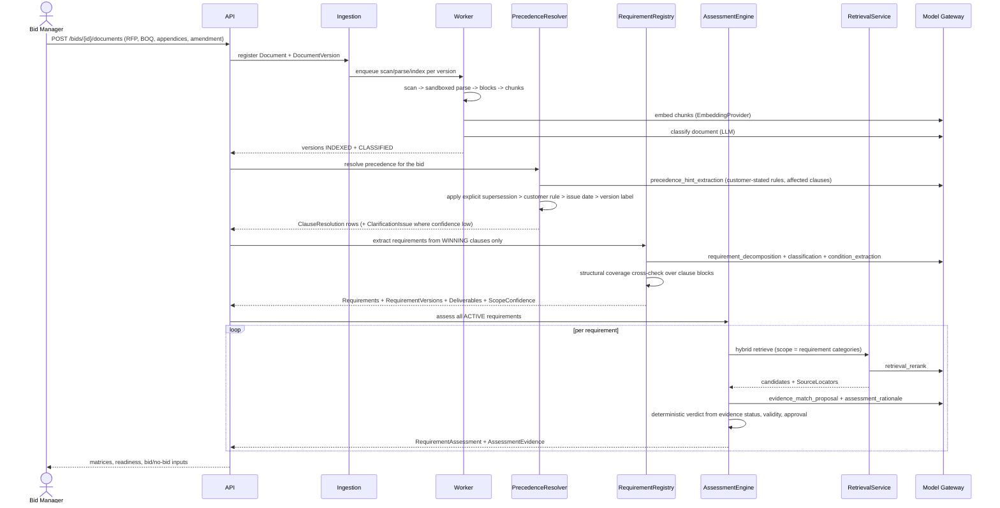
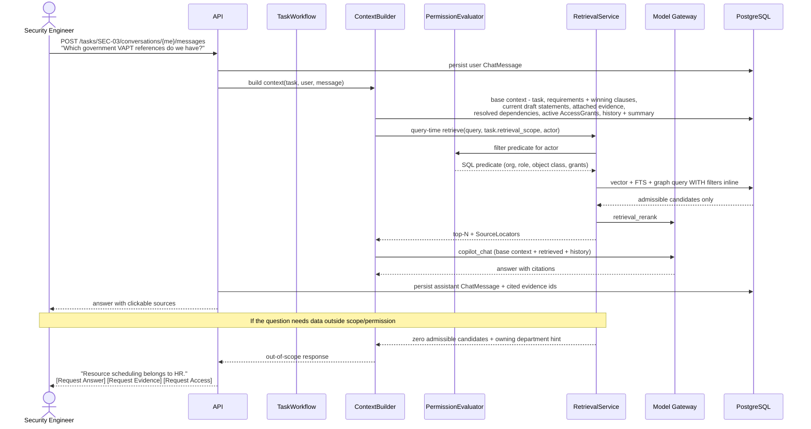
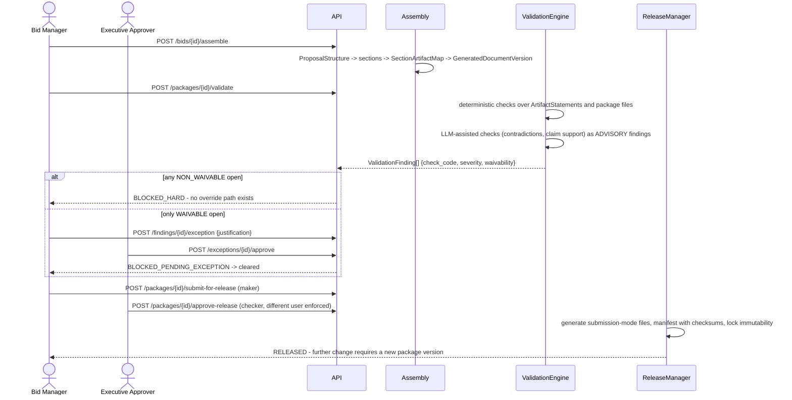
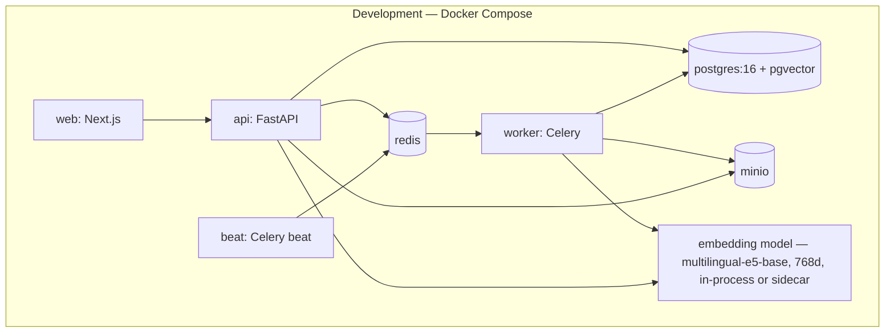

# BidReady — Phase B: Architecture and Sequence Design

Diagrams are Mermaid, kept in-repo and versioned with the code.

## 1. Component Architecture



**Reading the diagram.** Everything blue is deterministic and authoritative. The Model Gateway
(amber) is reached only from named call sites. Note that `RetrievalService` sits *between* the
Context Builder and the data, and that it consults `PermissionEvaluator` — the same one the UI
routers use. There is no path from a chat message to the database that bypasses it.

## 2. Ingestion Pipeline



**What we can and cannot promise about prompt injection.** Uploaded content is passed to the
model inside delimited data blocks, with a system instruction that content within them is data.
That reduces but does not eliminate influence: text inside a document *may* affect what the
model writes, and no delimiter or instruction makes a language model immune to that. The
guarantee we actually make is architectural, and it is about consequences rather than influence.
Injected text cannot widen any permission, because permissions are evaluated in SQL by the
`PermissionEvaluator` against the acting user, not decided by the model. It cannot reach a tool
or perform an action, because the model is given no tools and no side effects. It cannot change
workflow state, because every transition runs through a guarded domain service invoked by
application code. It cannot write to the system of record, because model output is a
schema-validated proposal that a deterministic service accepts or rejects through the normal
write path. And it cannot widen its own context, because the Context Builder — not the model —
decides what is retrieved. The residual risk is therefore *content* risk: a malicious document
could try to skew an extraction or a draft. That is mitigated by schema validation, by human
approval gates before anything is published, by provenance on every statement, and by adversarial
injection fixtures in the security test suite — not by claiming the channel does not exist.

## 3. Knowledge and Retrieval Architecture



The metadata boost is what makes "customer references" retrieve the *Referenceable Clients*
table rather than an unrelated CV: block type, heading path and table name are first-class
ranking signals, not an afterthought, because the ingestion layer preserved them.

## 4. AI Architecture

```mermaid
flowchart LR
  subgraph CALLERS["Named call sites only"]
    A1[tender_fact_extraction]
    A2[requirement_decomposition]
    A3[requirement_classification]
    A4[condition_extraction]
    A5[ambiguity_analysis]
    A6[precedence_hint_extraction]
    A7[knowledge_extraction]
    A8[evidence_match_proposal]
    A9[retrieval_rerank]
    A10[assessment_rationale]
    A11[department_assignment]
    A12[task_grouping]
    A13[copilot_chat]
    A14[draft_statement_generation]
    A15[conversation_summarization]
    A16[consistency_check]
    A17[validation_assist]
  end
  CALLERS --> GW[Model Gateway]
  GW --> PV[Prompt template + version]
  PV --> SCH[Response schema Pydantic]
  SCH --> CALL[DeepSeekProvider · model/temp/timeout from config]
  CALL --> VD{Schema valid?}
  VD -- no --> RP[Repair prompt · bounded retries]
  RP --> VD
  VD -- still no --> FAIL[Fail the job · audit · never write partial output]
  VD -- yes --> OUT[Typed object returned to the caller]
  OUT --> LOGU[Usage log: tokens · latency · prompt version · model version · request id]
  GW --- EMBI["EmbeddingProvider — separate interface, separate config, separate failure path"]
```



`generate_structured` is the default; free-text generation exists only for `copilot_chat` and
`draft_statement_generation`, and the latter still returns a typed statement list.

## 5. Sequence — RFP Intake through Assessment



Note the ordering: requirements are extracted from the clauses that *won* precedence, so an
amendment cannot be silently ignored, and a superseded clause cannot generate a phantom
requirement.

## 6. Sequence — Task Copilot with Query-Time Retrieval



## 7. Sequence — Cross-Department Request and Access Grant

```mermaid
sequenceDiagram
  actor SE as Security (requester)
  actor HR as HR (target)
  participant API
  participant CDR as CrossDeptRequestService
  participant AG as AccessGrantService
  participant TW as TaskWorkflow
  participant AUD as Audit

  SE->>API: POST /requests {type, task, requirement_ids, reason, resource?}
  API->>CDR: create request (PENDING)
  CDR->>TW: origin task -> WAITING_FOR_DEPENDENCY (or WAITING_FOR_ACCESS)
  CDR->>AUD: request_created
  API-->>HR: appears in Incoming Requests

  alt Provide Answer (no access granted)
    HR->>API: POST /requests/{id}/answer {text, optional evidence refs}
    CDR->>TW: attach answer to origin task context; task -> IN_PROGRESS
  else Share Evidence (task-scoped visibility)
    HR->>API: POST /requests/{id}/share-evidence {evidence_ids}
    CDR->>AG: create AccessGrant(scope=task, resource=evidence, permission=READ, expires_at)
    CDR->>TW: attach evidence to task; task -> IN_PROGRESS
  else Grant Access (broader resource)
    HR->>API: POST /requests/{id}/grant-access {resource, permission, expires_at}
    AG->>AG: AccessGrant ACTIVE, task-scoped, time-bounded, revocable
    CDR->>TW: task -> IN_PROGRESS
  else Reject
    HR->>API: POST /requests/{id}/reject {reason}
    CDR->>TW: task stays BLOCKED with logged reason
    CDR-->>SE: notified; Copilot explains what can still be completed
  end
  CDR->>AUD: resolution recorded with actor, reason, before/after
```

Least privilege is enforced by ordering: the UI presents *Provide Answer* first, and *Grant
Access* last. Every grant expires; grants are revoked automatically when the task completes or
the bid closes, and revocation takes effect on the next retrieval because permission filters
are evaluated per query rather than cached.

## 8. Sequence — Amendment Impact

```mermaid
sequenceDiagram
  actor BM as Bid Manager
  participant API
  participant ING as Ingestion
  participant PR as PrecedenceResolver
  participant AI2 as AmendmentImpact
  participant AE as AssessmentEngine
  participant TW as TaskWorkflow
  participant RAS as ArtifactStore

  BM->>API: upload Amendment_2.pdf
  API->>ING: ingest + classify (type=AMENDMENT, affected clauses extracted)
  ING->>PR: re-resolve precedence for affected clause refs only
  PR-->>AI2: changed ClauseResolutions
  AI2->>AI2: diff old vs new winning clause text per requirement
  AI2->>AI2: create RequirementVersion for changed requirements;<br/>prior version SUPERSEDED, requirement identity preserved
  AI2->>AE: mark dependent RequirementAssessments STALE
  AI2->>TW: tasks covering changed requirements -> REVALIDATION_REQUIRED
  AI2->>RAS: artifacts citing changed clauses/requirements -> REVALIDATION_REQUIRED
  AI2-->>BM: impact report: requirements changed, tasks and artifacts to revalidate
  Note over AI2: v1 is deliberately coarse - flag everything linked to the touched<br/>clause range. Over-flagging is recoverable; under-flagging is not.
```

## 9. Sequence — Validation and Release



## 9a. Background Workers and Invariants

Workers are a scheduling mechanism, not a privilege boundary. Every Celery task resolves
`(org_id, actor)` from its payload, opens a transaction, sets the tenant context with
`SET LOCAL`, and performs all writes through the same repositories and domain services the API
uses. RLS policies, composite tenant foreign keys, permission checks, state-transition guards
and audit writes therefore apply identically to background work. Workers act as an explicit
`WORKER` actor (or as the initiating user where the job carries one), and a transition a worker
is not permitted to make fails in the worker exactly as it would in a request handler. No task
opens a raw session or issues plain SQL against tenant tables.

## 10. Security Architecture

| Layer | Control |
|---|---|
| Transport | TLS everywhere; HSTS at the edge |
| Identity | Credential auth in dev behind an identity adapter; OIDC/SSO + MFA drop-in later; sessions short-lived with refresh; no business logic touches credentials |
| Authorization | One `PermissionEvaluator`: role → object class → `AccessGrant`. Called by UI reads, exports and retrieval alike |
| Tenancy | `org_id` on every table; composite `(id, org_id)` foreign keys make cross-tenant rows unrepresentable; RLS enabled and FORCEd on every tenant table including join tables; tenant context set with `SET LOCAL` inside each transaction so nothing leaks through a pooled connection; every vector and FTS query carries the tenant predicate inside the query |
| Upload safety | Type/size validation, malware scan, sandboxed parse, macros and OLE stripped, no embedded code execution, document text handled strictly as data |
| Prompt-injection | Uploaded content delimited as untrusted data; structured outputs only. Injected text may influence model output; it cannot widen permissions, reach tools, mutate workflow state, or write to the system of record — those are all outside the model's reach by construction. Adversarial fixtures in the security suite |
| Data at rest | Encrypted volumes and buckets; object keys namespaced per tenant; separate bucket prefixes for raw, generated and released artifacts |
| Secrets | Environment only (`DEEPSEEK_API_KEY` and friends); never in code, never in the database, never logged |
| Confidential classes | CVs and personal data, pricing, security architecture, privileged legal — object-level classification enforced on read, retrieval and export |
| Audit | Append-only `AuditEvent` with before/after state and request id; auditor role has read access to everything and write access to nothing |
| Retention | Configurable per tenant; legal hold overrides deletion; Celery beat runs retention and grant-expiry sweeps |

## 11. Deployment Architecture



Production keeps the same topology with managed equivalents. The only provider-specific code
is the object-storage adapter; region and residency are configuration. Nothing in the
application assumes a cloud vendor, so a UAE-hosted target — or a fully private deployment
with a local model behind `LLMProvider` — is a configuration and adapter change, not a rewrite.
