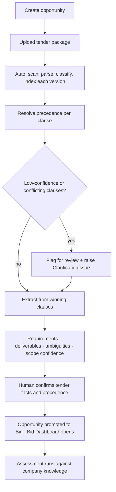
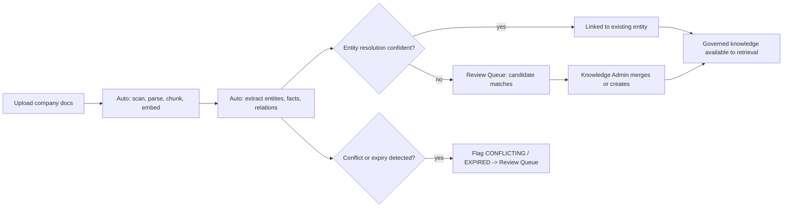
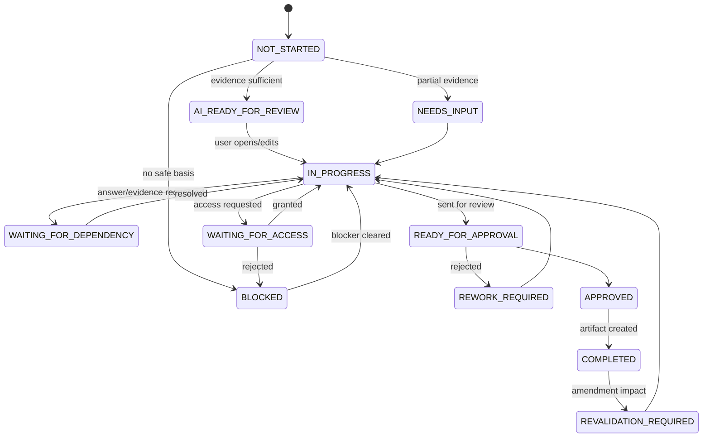
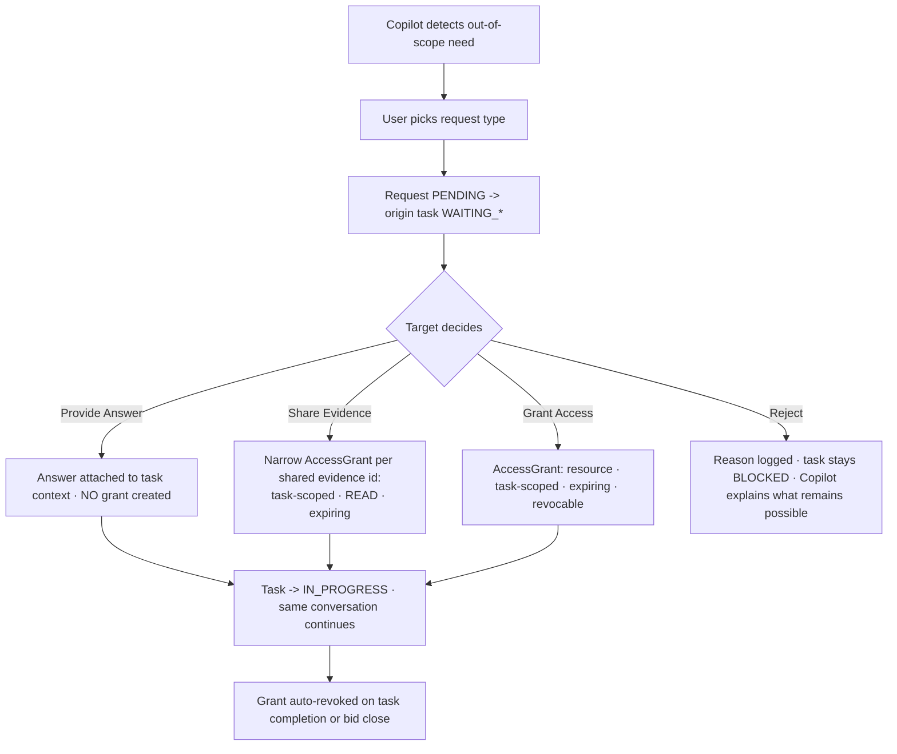
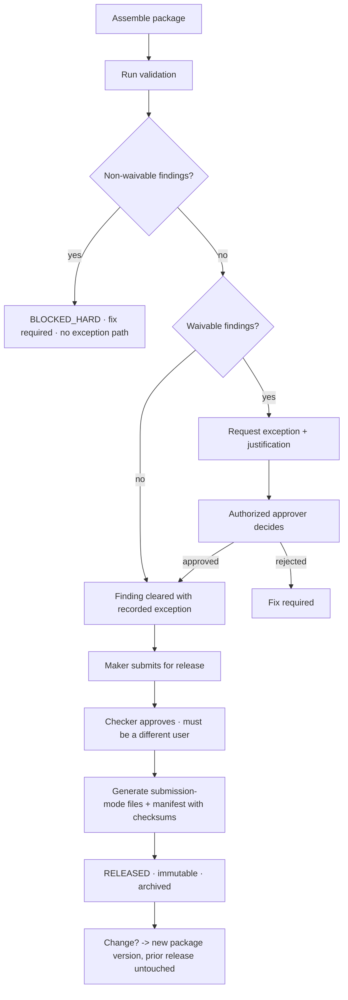
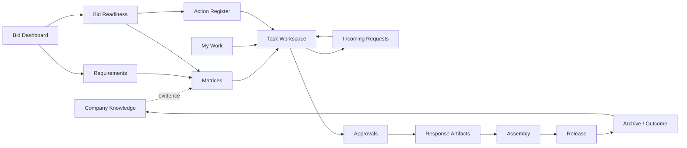

# BidReady — Phase B: UI Wireframes and User Flows

Low-fidelity, structural. The purpose is to agree *what is on each screen, what a user can do
there, and what state each action changes* before the schema is locked — because the workflow
is the differentiating part of the product. Visual design comes in Phase I.

Global shell for every screen:

```
+---------------------------------------------------------------------------------------+
| BidReady   [Bids v]  [Knowledge]  [My Work (7)]  [Requests (3)]  [Approvals (2)]       |
|                                                    org: Acme Cyber   Ahmed (Security) v|
+---------------------------------------------------------------------------------------+
| breadcrumb: Bids / ADNOC VAPT 2026 / Requirements / R-041                              |
+---------------------------------------------------------------------------------------+
```

Counters in the nav are live: My Work = items needing this user, Requests = incoming
cross-department requests, Approvals = items awaiting this user's approval.

---

## Screen 1 — Opportunity / New Bid / Tender Intake

The first screen in the product. Everything downstream depends on what is captured here, so it
is a three-step flow rather than a single form: create the opportunity, upload the package,
confirm what the system understood.

**Step 1 — create the opportunity**

```
+---------------------------------------------------------------------------------------+
| NEW OPPORTUNITY                                            step 1 of 3  [ Cancel ]      |
+---------------------------------------------------------------------------------------+
|  Customer          [ ADNOC                                    ]  (autocomplete from    |
|  Tender name       [ Penetration Testing Services 2026        ]   known clients)        |
|  Tender reference  [ TND-2026-114                             ]                         |
|  Submission dead.  [ 2026-10-12 ] [ 14:00 ] [ Asia/Dubai v ]                            |
|  Bid Manager       [ Sara K.          v ]   Account Manager [ Omar R.        v ]        |
|  Currency [ AED v ]  Region [ UAE       v ]  Est. value [ 2,400,000 ]                   |
|  Source   [ Portal | Email | Direct invitation | Public notice v ]                      |
|                                                                       [ Continue > ]    |
+---------------------------------------------------------------------------------------+
```

**Step 2 — upload the tender package**

```
+---------------------------------------------------------------------------------------+
| UPLOAD TENDER PACKAGE                                      step 2 of 3                  |
+---------------------------------------------------------------------------------------+
|  +---------------------------------------------------------------------------------+  |
|  |          Drop files here, or [ browse ]                                          |  |
|  |          PDF · DOCX · XLSX · ZIP     upload everything, including amendments      |  |
|  +---------------------------------------------------------------------------------+  |
|                                                                                         |
|  file                      detected type       issue date     status                    |
|  Main_RFP.pdf              RFP            v    2026-07-14     indexed        [ edit ]   |
|  Technical_Requirements.x  TECHNICAL_SPEC v    2026-07-14     indexed        [ edit ]   |
|  Commercial_BOQ.xlsx       BOQ            v    2026-07-14     indexed        [ edit ]   |
|  Appendix_A.docx           APPENDIX       v    2026-07-14     indexed        [ edit ]   |
|  Amendment_2.pdf           AMENDMENT      v    2026-08-11     indexed        [ edit ]   |
|  Clarification_1.pdf       CLARIFICATION  v    2026-08-19     scanning...               |
|  Terms.pdf                 TERMS          v    2026-07-14     ! parse failed [ retry ]  |
|                                                                                         |
|  Detected type and issue date are editable - they drive precedence, so getting them     |
|  right matters more than anywhere else in the product.                                  |
|                                             [ < Back ]  [ Analyse package > ]           |
+---------------------------------------------------------------------------------------+
```

**Step 3 — confirm what the system understood**

```
+---------------------------------------------------------------------------------------+
| CONFIRM TENDER UNDERSTANDING                               step 3 of 3                  |
+---------------------------------------------------------------------------------------+
| TENDER FACTS                            extracted - confirm or correct each             |
|   Customer            ADNOC                                        [ confirm ] [ edit ] |
|   Deadline            12 Oct 2026, 14:00 Asia/Dubai                [ confirm ] [ edit ] |
|   Technical contact   procurement@... (RFP p2)                     [ confirm ] [ edit ] |
|   Financial recipient tenders.finance@... (RFP p2, s2.4)           [ confirm ] [ edit ] |
|   Submission controls separate technical/financial recipients; encrypted PDF cost       |
|                       summary; password sent separately; 15 MB email limit              |
|                                                                    [ confirm ] [ edit ] |
+---------------------------------------------------------------------------------------+
| PRECEDENCE                                                                              |
|   clause 4.2   Amendment_2 (11 Aug) wins over Main_RFP     EXPLICIT_SUPERSESSION  0.96  |
|   clause 6.1   Clarification_1 (19 Aug) wins over          ISSUE_DATE             0.71  |
|                Amendment_2 (11 Aug)                        ! low confidence [ review ]  |
|   clause 9     Amendment_2 wins over Main_RFP              EXPLICIT_SUPERSESSION  0.93  |
+---------------------------------------------------------------------------------------+
| EXTRACTION SUMMARY                                                                      |
|   Requirements found          210    (mandatory 148 · conditional 17 · scored 96)       |
|   Deliverables identified      11                                                       |
|   Clarification issues          6    (2 blocking)                     [ review all ]    |
|   Clause coverage             98%    4 clause blocks produced no requirement [ review ] |
|                                                                                         |
|   SCOPE CONFIDENCE            MEDIUM                                                    |
|     technical MEDIUM · commercial HIGH · security HIGH · implementation LOW             |
|     Conditional drafting allowed - assumptions must be recorded.                        |
|     Based on tender clarity only: coverage, ambiguities, contradictions, unresolved      |
|     clauses. Whether we hold matching evidence is a separate question, answered on the   |
|     Readiness screen.                                                                    |
+---------------------------------------------------------------------------------------+
|                                        [ < Back ]  [ Confirm and open bid ]             |
+---------------------------------------------------------------------------------------+
```



Scope Confidence is shown here, at intake, because it is a statement about the *tender* — how
well we understand what is being asked. It never moves because of what evidence we do or do not
hold; that appears later, on Readiness.

---

## Screen 2 — Company Knowledge

```
+---------------------------------------------------------------------------------------+
| COMPANY KNOWLEDGE                                     [ Upload documents ]  [ + Entity ]|
+---------------------------------------------------------------------------------------+
| [ Documents ] [ Entities ] [ Facts & Relations ] [ Review Queue (12) ] [ Expiring (5) ] |
+---------------------------------------------------------------------------------------+
| Filters: type v | classification v | owner v | status v | valid on [2026-08-30]         |
+---------------------------------------------------------------------------------------+
| ENTITIES                                                                                |
| +-----------------------------------------------------------------------------------+ |
| | Person   Ahmed Hassan          9 facts · 14 relations   CURRENT_VERIFIED     [open] | |
| | Person   Zain Malik            7 facts · 11 relations   NEEDS_CONFIRMATION   [open] | |
| | Project  Ministry VAPT 2024   12 facts ·  9 relations   CURRENT_VERIFIED     [open] | |
| | Cert     CREST                  4 facts ·  3 relations   EXPIRES IN 61 DAYS  [open] | |
| +-----------------------------------------------------------------------------------+ |
+---------------------------------------------------------------------------------------+
```

Entity detail — the graph made legible, with proof attached to every line:

```
+---------------------------------------------------------------------------------------+
| PERSON · Ahmed Hassan            aliases: A. Hassan, Ahmed H.        [Edit] [Supersede] |
+---------------------------------------------------------------------------------------+
| FACTS                                                                                   |
| predicate          value            valid            status             source          |
| role               Lead Pentester   2023-01 -> open  CURRENT_VERIFIED   CV_Ahmed.pdf p2 |
| years_experience   9                2026-01 -> open  CURRENT_VERIFIED   CV_Ahmed.pdf p1 |
| availability       60% Q4           2026-07 -> 12-31 NEEDS_CONFIRMATION HR sheet r14    |
+---------------------------------------------------------------------------------------+
| RELATIONS                                                                               |
| Ahmed --HAS_CERTIFICATION--> OSCP    #OS-101923  2024-03 -> 2027-03  CURRENT_VERIFIED   |
| Ahmed --HAS_CERTIFICATION--> CREST   #CR-8871    2023-05 -> 2026-10  EXPIRING           |
| Ahmed --WORKED_ON--> Ministry VAPT 2024  {role: Lead Tester}         HISTORICAL_VERIFIED|
| Ahmed --EMPLOYED_BY--> Acme Cyber        2019-02 -> open             CURRENT_VERIFIED   |
+---------------------------------------------------------------------------------------+
| [ Add fact ] [ Add relation ] [ Request confirmation ] [ View all evidence ]            |
+---------------------------------------------------------------------------------------+
```

Every row is click-through to the exact source location (document, page, heading, table row).
Conflicts render inline as a paired row with a *Resolve* action that routes to the Knowledge
Administrator; the system never silently prefers one.



---

## Screen 3 — Bid Dashboard

```
+---------------------------------------------------------------------------------------+
| ADNOC VAPT 2026            ref TND-2026-114     deadline 12 Oct 2026 (43 days)         |
| Bid Manager: Sara K.   Account: Omar R.   Value: AED 2.4M   Stage: IN_PROGRESS         |
+---------------------------------------------------------------------------------------+
| READINESS                                                                               |
|  Requirement coverage  [############----]  92%     Critical blockers        2           |
|  Evidence readiness    [###########-----]  87%     Client clarifications    4           |
|  Task completion       [#########-------]  74%     Waiting dependencies     3           |
|  Approval completion   [########--------]  63%     Revalidation required    6           |
|  Package readiness     [######----------]  48%                                          |
|  (every number is clickable -> filtered list -> per-item audit trail)                   |
+---------------------------------------------------------------------------------------+
| DOCUMENTS & PRECEDENCE                                        [ Upload ] [ Resolve (2) ]|
|  Main_RFP.pdf            v1  original      2026-07-14  INDEXED                          |
|  Amendment_2.pdf         v1  amendment     2026-08-11  INDEXED  affects 4.2, 6.1, 9     |
|  Clarification_1.pdf     v1  clarification 2026-08-19  INDEXED  affects 6.1             |
|  ! clause 6.1 - clarification (19 Aug) supersedes amendment (11 Aug)  [review decision] |
+---------------------------------------------------------------------------------------+
| [ Requirements 210 ] [ Matrices ] [ Tasks 34 ] [ Readiness ] [ Assembly ] [ Release ]   |
+---------------------------------------------------------------------------------------+
```

The precedence banner is deliberately prominent and always shows the *resolved winner plus the
method*. Low-confidence resolutions surface as a `Resolve` action rather than a silent choice.

---

## Screen 4 — Matrices

```
+---------------------------------------------------------------------------------------+
| MATRICES   [ Eligibility ] [ Technical ] [ Submission ] [ Contract ]   [ Export v ]     |
+---------------------------------------------------------------------------------------+
| filter: category v  mandatory v  evidence status v  readiness v  owner v  [search]      |
+---------------------------------------------------------------------------------------+
| ID    Requirement                    Cat      M  Evidence status     Readiness   Owner  |
| R-041 Bidder must hold CREST         ELIG     Y  CURRENT_VERIFIED    READY       SEC    |
| R-042 Two OSCP-certified testers     STAFF    Y  PARTIAL             NEEDS_CONF  HR     |
| R-043 Submit tester CVs              DOC      Y  CURRENT_VERIFIED    REQ_SIGNAT  HR     |
| R-047 Three relevant projects        EXP      Y  HISTORICAL_VERIFIED NEEDS_REFR  SALES  |
| R-051 Subcontractor profile          LEGAL    C  --                  NOT_APPLIC  --     |
|                                              ^ conditional, condition evaluated false   |
+---------------------------------------------------------------------------------------+
| Row expand:                                                                             |
|  clause  Main_RFP.pdf s4.2 p11 (winning version)              [view source]             |
|  evidence  CREST cert #CR-8871 valid to 2026-10-14  CURRENT   [view] [refresh]          |
|            Ahmed HAS_CERTIFICATION CREST                       [view in graph]          |
|  assessment rationale + who/what computed it, and any human adjustment                  |
|  tasks  SEC-03 (IN_PROGRESS)    artifacts  none yet    actions  A-002                   |
+---------------------------------------------------------------------------------------+
```

Two status columns, never collapsed into one. `NOT_APPLICABLE` conditionals are visibly
excluded from gap counts so nobody chases a phantom gap.

---

## Screen 5 — My Work

```
+---------------------------------------------------------------------------------------+
| MY WORK — Ahmed (Security)                                    across all bids [filter v]|
+---------------------------------------------------------------------------------------+
|  Ready for approval  5  |  Needs my input  3  |  In progress  4                         |
|  Waiting on others   2  |  Incoming requests 3 |  Completed   11                        |
+---------------------------------------------------------------------------------------+
| NEEDS MY INPUT                                                                          |
| SEC-03  VAPT Methodology        ADNOC VAPT 2026  due 04 Sep  HIGH   NEEDS_INPUT         |
|         covers R-041 R-042 R-043 R-047 · blocker: awaiting HR availability confirmation |
| SEC-07  Security questionnaire  ADNOC VAPT 2026  due 06 Sep  MED    AI_READY_FOR_REVIEW |
|         AI draft prepared from 6 evidence items · 2 assumptions flagged                 |
| SEC-11  DR / resilience         DEWA GRC 2026    due 09 Sep  MED    WAITING_FOR_ACCESS  |
|         requested access to DR runbook · pending with Infrastructure                    |
+---------------------------------------------------------------------------------------+
```

Every row shows bid, task, due date, priority, status, the current blocker and the
requirements covered — enough to triage without opening anything.

---

## Screen 6 — Task Workspace with Copilot

The core screen. Three panes: requirements and evidence (left), the draft (centre), the
Copilot (right).

```
+---------------------------------------------------------------------------------------+
| TASK SEC-03 · VAPT Methodology    ADNOC VAPT 2026   IN_PROGRESS   due 04 Sep  [Actions v]|
+------------------+--------------------------------------------+-----------------------+
| REQUIREMENTS (4) | DRAFT RESPONSE  artifact v3 (DRAFT)        | COPILOT · my session  |
|                  |                                            |                       |
| R-041 CREST      | [E] We hold CREST accreditation, valid     | me: Which government  |
|   READY          |     to 14 Oct 2026.                        | VAPT references do    |
|   [view clause]  |     -> CREST cert #CR-8871 [view]          | we have?              |
|                  |                                            |                       |
| R-042 2x OSCP    | [E] Our testing team includes two          | AI: Three, all        |
|   NEEDS_CONF     |     OSCP-certified testers.                | admissible for this   |
|   ! availability |     -> Ahmed OSCP #OS-101923 [view]        | task:                 |
|                  |     -> Zain OSCP #OS-114552 [view]         | 1 Ministry VAPT 2024  |
| R-043 CVs        |                                            |   (Ref sheet p3)      |
|   REQ_SIGNATURE  | [C] We will hold weekly progress meetings  | 2 Municipality PT     |
|                  |     with the client throughout delivery.    |   2023 (Ref sheet p4) |
| R-047 3 projects |     PROPOSED COMMITMENT · owner: Sara K.    | 3 Utility GRC 2025    |
|   NEEDS_REFRESH  |     [ Send for approval ]                   |   (Case study p2)     |
|                  |                                            |                       |
| EVIDENCE (6)     | [A] We assume VPN access to the test        | Ref 3 is 14 months    |
|  CREST cert   OK | environment will be provided by the client. | old - may need a      |
|  Ahmed OSCP   OK |     ASSUMPTION · Ahmed · 30 Aug             | refresh for "recent". |
|  Zain OSCP    OK |     [ Resolve ] [ Carry into submission ]   |                       |
|  Ministry ref !  |                                            | me: Is Zain available |
|  Method v4    OK | [T] Per RFP s6.1 (as amended), testing     | for eight weeks?      |
|  Case study   OK |     covers 35 applications.                 |                       |
|                  |     -> Amendment_2.pdf s6.1 [view]          | AI: That is resource  |
| [ + Add evidence]|                                            | scheduling, owned by  |
|                  | legend [E] evidence [C] commitment          | HR, and outside this  |
|                  |        [A] assumption [T] tender-derived     | task's scope.         |
|                  |                                            | [Request Answer]      |
|                  | [ Save ] [ Send for review ]                | [Request Evidence]    |
|                  |                                            | [Request Access]      |
+------------------+--------------------------------------------+-----------------------+
```

The statement-class prefixes are the visible face of correction 8. A reviewer can see at a
glance which sentences are claims needing proof, which are promises needing approval, and
which are assumptions. The Copilot's out-of-scope answer offers the three request types in
least-privilege order rather than refusing flatly.



---

## Screen 7 — Incoming Requests

```
+---------------------------------------------------------------------------------------+
| INCOMING REQUESTS — HR                                        [ open ] [ resolved ] (3) |
+---------------------------------------------------------------------------------------+
| From    Ahmed - Security          Task SEC-03      Requirement R-042    2h ago  PENDING |
| Type    REQUEST ANSWER                                                                  |
| Ask     Confirm Zain Malik's availability for an 8-week engagement from 15 Oct.         |
| Reason  R-042 requires two OSCP testers; staffing must be confirmed before drafting.    |
|                                                                                         |
| [ Provide Answer ]  [ Share Evidence ]  [ Grant Access ]  [ Reject ]                    |
|   no access granted   task-scoped, expiring  full resource, expiring   reason required  |
+---------------------------------------------------------------------------------------+
| Grant Access dialog                                                                     |
|   resource   HR availability sheet - Q4 2026                                            |
|   scope      Task SEC-03 only          permission  READ                                 |
|   expires    [ 2026-10-12 ] (defaults to bid deadline)      [ revocable at any time ]   |
|   reason     [                                             ]                            |
|   ! Prefer Provide Answer or Share Evidence where they satisfy the need.                |
+---------------------------------------------------------------------------------------+
```



---

## Screen 8 — Approvals

```
+---------------------------------------------------------------------------------------+
| APPROVALS — awaiting me (2)               [ my queue ] [ all for this bid ] [ history ] |
+---------------------------------------------------------------------------------------+
| SEC-07 Security questionnaire   ADNOC VAPT 2026   from Ahmed   Technical Review   HIGH  |
|   6 evidence-backed facts · 1 proposed commitment · 2 assumptions · 0 unsupported       |
|   [ Review ]                                                                            |
+---------------------------------------------------------------------------------------+
| Review view — statement by statement, not a wall of prose                               |
| +-------------------------------------------------------------------------------------+|
| | [E] "We hold ISO 27001 certification."                                    APPROVE  v ||
| |     evidence: ISO cert #ISO-4471 valid to 2027-02  CURRENT_VERIFIED  [view source]   ||
| | [C] "We will provide a dedicated security manager."                       APPROVE  v ||
| |     PROPOSED COMMITMENT · needs Commercial sign-off  · owner Sara K.                 ||
| | [A] "We assume the client provides test credentials by day 3."            APPROVE  v ||
| |     ASSUMPTION · will appear in the assumptions register                             ||
| +-------------------------------------------------------------------------------------+|
| [ Approve all ]  [ Request rework ]  [ Comment ]     -> creates ResponseArtifact v1     |
+---------------------------------------------------------------------------------------+
```

Approval is per statement, which is what makes the chain meaningful: a technical reviewer can
approve the facts while a commitment still waits on Commercial.

---

## Screen 9 — Bid Readiness

```
+---------------------------------------------------------------------------------------+
| BID READINESS — ADNOC VAPT 2026                                 [ export report ]       |
+---------------------------------------------------------------------------------------+
| Total requirements 210    (conditional NOT_APPLICABLE 11 excluded from gaps)            |
|                                                                                         |
|  READY                       142  ############################                          |
|  DRAFTABLE                    18  ####                                                  |
|  NEEDS_REFRESH                14  ###                                                   |
|  NEEDS_COMPANY_CONFIRMATION   12  ##                                                    |
|  NEEDS_CLIENT_CLARIFICATION    9  ##                                                    |
|  REQUIRES_SIGNATURE            4  #                                                     |
|  BLOCKED                       4  #                                                     |
|  (click any bar -> the requirements behind it -> each item's assessment and audit trail)|
+---------------------------------------------------------------------------------------+
| BID / NO-BID GATE                                    AMBER      [ record decision ]     |
|   Critical accreditation (CREST)   PASS   expires 14 Oct - inside submission window     |
|   Client references                REFRESH  3 required, newest is 14 months old          |
|   Scope clarification              OPEN     4 clarifications outstanding (clause 6.1)    |
|   Performance bond                 OPEN     Finance confirmation required                |
+---------------------------------------------------------------------------------------+
| ACTION REGISTER (canonical - one action, referenced everywhere)                          |
|   A-001  Refresh three client references     Sales   due 05 Sep  blocks SEC-03, SAL-02  |
|   A-002  Confirm PM availability             HR      due 03 Sep  blocks PM-01           |
|   A-003  Client clarification: clause 6.1    BidMgr  due 02 Sep  blocks 9 requirements  |
|   A-004  Obtain Director signature           Legal   due 09 Sep  blocks LEG-04          |
+---------------------------------------------------------------------------------------+
```

---

## Screen 10 — Release and Package

```
+---------------------------------------------------------------------------------------+
| RELEASE — ADNOC VAPT 2026        Package v1 (draft)     [ Review mode ] [ Submission ]  |
+---------------------------------------------------------------------------------------+
| VALIDATION — last run 30 Aug 14:22                                    [ re-run ]        |
|                                                                                         |
| NON-WAIVABLE (blocks absolutely - no override exists)                             0     |
|   tenant leakage · permission violation · malware · corrupted file ·                    |
|   restricted content in outgoing package                                                |
|                                                                                         |
| WAIVABLE (blocks until an authorized exception is approved)                       3     |
|   ! Mandatory requirement R-118 unanswered                       [ open ] [ except ]    |
|   ! Unsupported claim in Technical s4.2 - no live evidence link   [ open ] [ except ]   |
|   ! Required file missing: Signed_Declaration.pdf                [ open ] [ except ]    |
|                                                                                         |
| WARNINGS (do not block)                                                           7     |
+---------------------------------------------------------------------------------------+
| PACKAGE CONTENTS                                                                        |
|  Technical_Proposal.docx      v3  2.4 MB  a1b2c3...  APPROVED   -> technical recipient  |
|  Commercial_Proposal.pdf      v2  0.9 MB  d4e5f6...  APPROVED   -> financial recipient  |
|  Compliance_Matrix.xlsx       v3  0.4 MB  7a8b9c...  APPROVED   -> technical recipient  |
|  BOQ.xlsx                     v2  0.2 MB  0d1e2f...  PENDING    -> financial recipient  |
|  CV_Package.pdf               v1  5.1 MB  3a4b5c...  APPROVED   -> technical recipient  |
+---------------------------------------------------------------------------------------+
| RELEASE APPROVALS (maker-checker - maker cannot be checker)                             |
|  Technical  Sara K.  30 Aug     Security  Ahmed  30 Aug     Legal    pending            |
|  Commercial pending              Bid Mgr   pending           Final    pending            |
|                                                                                         |
| [ Submit for release ]  disabled - 3 waivable findings open, 3 approvals outstanding    |
+---------------------------------------------------------------------------------------+
```



---

## Cross-screen navigation



Two navigation invariants worth stating: every number on a dashboard drills to the items
behind it and then to that item's audit trail, and every claim in a draft or matrix drills to
its exact source location. If a screen shows a figure a user cannot trace, that is a defect.
