# BidReady — Phase C: Data Model, Schema, Enums, State Machines

PostgreSQL 16 + pgvector. SQLAlchemy 2 models, Alembic migrations, Pydantic v2 schemas.

## 1. Conventions

- **Primary keys** `UUID` (v7 where available for index locality), column `id`.
- **Tenancy** every table except `organization` carries `org_id UUID NOT NULL REFERENCES organization(id)`. Composite indexes lead with `org_id`. Cross-tenant relationships are made structurally impossible by the database, not by application discipline — see section 14.1. Row-level security is enabled on **every** tenant table including join tables, with the tenant context set transaction-locally.
- **Audit columns** `created_at`, `created_by`, `updated_at`, `updated_by` on all mutable tables. Immutable tables (versions, audit, chat messages) carry `created_*` only.
- **Soft delete** not used. Withdrawal/supersession is modelled explicitly with status columns so history is never ambiguous.
- **Enums** PostgreSQL native `ENUM` types, mirrored as Python `StrEnum`. Adding a value is a migration; the application never persists an unmapped string.
- **Timestamps** `TIMESTAMPTZ`, stored UTC.
- **Free-form structured data** `JSONB`, always with a Pydantic model governing its shape. JSONB is never used to avoid designing a column that should exist.
- **Text search** `tsvector` generated columns with GIN indexes.
- **Vectors** `vector(768)`, **locked for v1** to the selected embedding model `intfloat/multilingual-e5-base` (768 dimensions). `pgvector` column dimensions are fixed at DDL time and cannot vary at runtime, so the dimension is a schema constant, not configuration. `embedding.model_id` records which model produced each row so a model change is a detectable, migrated re-index rather than silent corruption — see section 14.4 for the reindex procedure.
- **Naming** singular table names, `snake_case`, foreign keys `<entity>_id`.

## 2. Entity-Relationship Overview

```mermaid
erDiagram
  ORGANIZATION ||--o{ DEPARTMENT : has
  ORGANIZATION ||--o{ USER : has
  USER }o--o{ ROLE : user_role
  USER }o--o{ DEPARTMENT : user_department
  ROLE }o--o{ PERMISSION : role_permission

  ORGANIZATION ||--o{ DOCUMENT : owns
  DOCUMENT ||--o{ DOCUMENT_VERSION : versions
  DOCUMENT_VERSION ||--|| DOCUMENT_CLASSIFICATION : classified
  DOCUMENT_VERSION ||--o{ DOCUMENT_BLOCK : blocks
  DOCUMENT_BLOCK ||--o{ DOCUMENT_CHUNK : chunks
  DOCUMENT_CHUNK ||--|| EMBEDDING : embedded
  DOCUMENT_VERSION }o--o{ DOCUMENT_VERSION : document_relation

  KNOWLEDGE_ENTITY ||--o{ KNOWLEDGE_FACT : facts
  KNOWLEDGE_ENTITY ||--o{ KNOWLEDGE_RELATION : subject_of
  KNOWLEDGE_ENTITY ||--o{ KNOWLEDGE_RELATION : object_of
  EVIDENCE ||--o{ EVIDENCE_LINK : links
  DOCUMENT_VERSION ||--o{ EVIDENCE : sourced_from

  OPPORTUNITY ||--|| BID : becomes
  BID ||--o{ DOCUMENT : tender_docs
  BID ||--o{ REQUIREMENT : requirements
  REQUIREMENT ||--o{ REQUIREMENT_VERSION : versions
  BID ||--o{ CLAUSE_RESOLUTION : precedence
  BID ||--o{ CLARIFICATION_ISSUE : issues
  BID ||--o{ DELIVERABLE : deliverables

  REQUIREMENT ||--o{ REQUIREMENT_ASSESSMENT : assessed_by
  REQUIREMENT_ASSESSMENT ||--o{ ASSESSMENT_EVIDENCE : cites
  EVIDENCE ||--o{ ASSESSMENT_EVIDENCE : used_in

  BID ||--o{ TASK : tasks
  TASK }o--o{ REQUIREMENT : task_requirement
  TASK ||--o{ TASK_DEPENDENCY : depends
  TASK ||--o{ TASK_PARTICIPANT : participants
  TASK ||--o{ TASK_CONVERSATION : conversations
  TASK_CONVERSATION ||--o{ CHAT_MESSAGE : messages
  TASK_CONVERSATION ||--o{ CONVERSATION_SUMMARY : summaries
  TASK ||--o{ CROSS_DEPARTMENT_REQUEST : origin_of
  CROSS_DEPARTMENT_REQUEST ||--o| ACCESS_GRANT : may_create
  TASK ||--o{ ACCESS_GRANT : scoped_to

  TASK ||--o{ RESPONSE_ARTIFACT : produces
  RESPONSE_ARTIFACT ||--o{ ARTIFACT_VERSION : versions
  ARTIFACT_VERSION ||--o{ ARTIFACT_STATEMENT : statements
  ARTIFACT_STATEMENT ||--o| COMMITMENT : commits
  ARTIFACT_STATEMENT ||--o| ASSUMPTION : assumes

  BID ||--|| PROPOSAL_STRUCTURE : structure
  PROPOSAL_STRUCTURE ||--o{ PROPOSAL_SECTION : sections
  PROPOSAL_SECTION }o--o{ RESPONSE_ARTIFACT : section_artifact_map
  PROPOSAL_STRUCTURE ||--o{ GENERATED_DOCUMENT : documents
  GENERATED_DOCUMENT ||--o{ GENERATED_DOCUMENT_VERSION : versions
  PACKAGE ||--o{ PACKAGE_ITEM : items
  PACKAGE ||--|| MANIFEST : manifest
  PACKAGE ||--o{ VALIDATION_RUN : validations
  VALIDATION_RUN ||--o{ VALIDATION_FINDING : findings
  VALIDATION_FINDING ||--o| RELEASE_EXCEPTION : waived_by

  BID ||--o{ ACTION : actions
  BID ||--o| OUTCOME : outcome
  OUTCOME ||--o{ KNOWLEDGE_UPDATE_CANDIDATE : proposes
```



## 3. Enumerations

```
-- identity
role_code:            ORG_ADMIN | BID_MANAGER | SALES | TECHNICAL_CONTRIBUTOR |
                      SOLUTION_ARCHITECT | PROJECT_MANAGER | SECURITY | HR |
                      COMMERCIAL | FINANCE | LEGAL | REVIEWER | EXECUTIVE_APPROVER |
                      KNOWLEDGE_ADMIN | AUDITOR
department_code:      SECURITY | HR | PMO | SALES | COMMERCIAL | FINANCE | LEGAL |
                      BID_MANAGEMENT | PRODUCT | SOLUTION_ARCHITECTURE | QUALITY
confidentiality_class: PUBLIC | INTERNAL | CONFIDENTIAL | RESTRICTED | PRIVILEGED

-- bid lifecycle
bid_state:            DRAFT | INTAKE_IN_PROGRESS | UNDERSTANDING_COMPLETE |
                      ASSESSMENT_COMPLETE | BID_NO_BID_DECIDED | IN_PROGRESS | ASSEMBLY |
                      VALIDATION | RELEASE_PENDING | RELEASED | ARCHIVED | NO_BID | CANCELLED

-- documents
document_side:        TENDER | COMPANY
document_type:        RFP | RFQ | AMENDMENT | CLARIFICATION | TECHNICAL_SPECIFICATION |
                      BOQ | COMMERCIAL_TEMPLATE | RESPONSE_TEMPLATE | TERMS_AND_CONDITIONS |
                      APPENDIX | FORM | QUESTIONNAIRE |
                      COMPANY_PROFILE | PREVIOUS_PROPOSAL | PROJECT_REFERENCE | CASE_STUDY |
                      CV | CERTIFICATE | POLICY | METHODOLOGY | ARCHITECTURE | PRODUCT_DOC |
                      SECURITY_DOC | SUPPORT_DOC | LEGAL_DOC | COMMERCIAL_DOC | RATE_CARD |
                      OTHER
document_version_state: UPLOADED | SCANNING | SCAN_FAILED | QUARANTINED | PARSING |
                      PARSE_FAILED | PARSED | CLASSIFIED | INDEXED | ACTIVE | SUPERSEDED
block_type:           HEADING | PARAGRAPH | LIST_ITEM | TABLE | TABLE_ROW | TABLE_CELL |
                      FIGURE_CAPTION | FORM_FIELD | FOOTNOTE | PAGE_HEADER | PAGE_FOOTER
document_relation_type: AMENDS | CLARIFIES | SUPERSEDES | REPLACES_CLAUSE | ATTACHMENT_OF |
                      TRANSLATION_OF
precedence_method:    EXPLICIT_SUPERSESSION | CUSTOMER_STATED_RULE | ISSUE_DATE |
                      VERSION_LABEL | DOCUMENT_TYPE_DEFAULT | MANUAL

-- knowledge
entity_type:          PERSON | PROJECT | CERTIFICATION | CLIENT | PRODUCT | METHODOLOGY |
                      POLICY | LEGAL_ENTITY | OFFICE | RATE_CARD | PARTNER |
                      ACCREDITATION_BODY | TECHNOLOGY
relation_predicate:   HAS_CERTIFICATION | WORKED_ON | EMPLOYED_BY | DELIVERED_FOR |
                      HOLDS_ROLE | ISSUED_BY | SUBCONTRACTOR_OF | REFERENCES | PART_OF |
                      USES_TECHNOLOGY | GOVERNED_BY | SUPERSEDED_BY
knowledge_status:     CURRENT_VERIFIED | HISTORICAL_VERIFIED | PROPOSED | NEEDS_CONFIRMATION |
                      CONFLICTING | EXPIRED | REJECTED | SUPERSEDED
approval_status:      DRAFT | PENDING_APPROVAL | APPROVED | REJECTED | WITHDRAWN
evidence_link_target: KNOWLEDGE_FACT | KNOWLEDGE_RELATION | KNOWLEDGE_ENTITY |
                      REQUIREMENT_ASSESSMENT | ARTIFACT_STATEMENT
evidence_link_role:   SUPPORTS | PARTIALLY_SUPPORTS | CONTRADICTS | CONTEXT

-- requirements
requirement_category: TECHNICAL | FUNCTIONAL | NON_FUNCTIONAL | SECURITY | IMPLEMENTATION |
                      PROJECT_MANAGEMENT | SUPPORT | TRAINING | DOCUMENTATION | STAFFING |
                      ELIGIBILITY | ADMINISTRATIVE | SUBMISSION | LEGAL | COMMERCIAL |
                      CONTRACTUAL
requirement_lifecycle: DRAFT_EXTRACTED | CONFIRMED | SUPERSEDED | WITHDRAWN
requirement_applicability: ACTIVE | NOT_APPLICABLE | CONDITIONAL_PENDING
risk_level:           LOW | MEDIUM | HIGH | CRITICAL
scope_confidence:     HIGH | MEDIUM | LOW
clarification_severity: INFO | MINOR | MAJOR | BLOCKING

-- assessment
evidence_status:      CURRENT_VERIFIED | HISTORICAL_VERIFIED | PARTIAL | CONFLICTING |
                      NONE | EXPIRED
bid_readiness:        READY | DRAFTABLE | NEEDS_REFRESH | NEEDS_COMPANY_CONFIRMATION |
                      NEEDS_CLIENT_CLARIFICATION | REQUIRES_SIGNATURE | BLOCKED |
                      NOT_APPLICABLE
assessment_state:     PENDING | COMPUTED | HUMAN_ADJUSTED | STALE
assessment_evidence_role: PRIMARY | SUPPORTING | PARTIAL | CONTRADICTING | REFERENCE
bid_no_bid:           GREEN | AMBER | RED

-- tasks and collaboration
task_state:           NOT_STARTED | AI_READY_FOR_REVIEW | NEEDS_INPUT | IN_PROGRESS |
                      WAITING_FOR_DEPENDENCY | WAITING_FOR_ACCESS | READY_FOR_APPROVAL |
                      REWORK_REQUIRED | APPROVED | COMPLETED | BLOCKED |
                      REVALIDATION_REQUIRED
task_dependency_type: BLOCKS | WAITS_FOR
participant_role:     CONTRIBUTOR | REVIEWER | APPROVER | OBSERVER
chat_role:            USER | ASSISTANT | SYSTEM_SUMMARY | SYSTEM_EVENT
request_type:         REQUEST_ANSWER | REQUEST_EVIDENCE | REQUEST_ACCESS
request_state:        PENDING | ACKNOWLEDGED | ANSWERED | EVIDENCE_SHARED | ACCESS_GRANTED |
                      REJECTED | CANCELLED | EXPIRED
grant_state:          ACTIVE | EXPIRED | REVOKED
grant_permission:     READ | READ_EXPORT

-- artifacts and assembly
statement_class:      EVIDENCE_BACKED_FACT | TENDER_DERIVED | PROPOSED_COMMITMENT |
                      ASSUMPTION | HUMAN_PROVIDED_INPUT
statement_approval:   DRAFT | PENDING | APPROVED | REJECTED
artifact_state:       DRAFT | SUBMITTED_FOR_REVIEW | IN_REVIEW | APPROVED |
                      REWORK_REQUIRED | REVALIDATION_REQUIRED | SUPERSEDED
artifact_version_state: DRAFT | SUBMITTED_FOR_REVIEW | IN_REVIEW | APPROVED |
                      REWORK_REQUIRED | SUPERSEDED
review_decision:      APPROVED | REJECTED | CHANGES_REQUESTED
generated_format:     DOCX | XLSX | PDF | CSV | ZIP
output_mode:          REVIEW | SUBMISSION

-- validation and release
finding_severity:     INFO | WARNING | BLOCKING
finding_waivability:  WAIVABLE | NON_WAIVABLE
package_state:        ASSEMBLING | REVIEW_MODE_READY | VALIDATION_RUNNING |
                      BLOCKED_HARD | BLOCKED_PENDING_EXCEPTION | RELEASE_PENDING_APPROVALS |
                      RELEASED | ARCHIVED | SUPERSEDED
exception_state:      REQUESTED | APPROVED | REJECTED

-- outcome
outcome_result:       WON | LOST | NO_BID | CANCELLED
candidate_state:      PROPOSED | UNDER_REVIEW | APPROVED | REJECTED
```

## 4. Identity, Tenancy, Permissions

```sql
organization(id PK, name, slug UNIQUE, retention_days INT, residency_region TEXT,
             default_language TEXT DEFAULT 'en', created_at, updated_at)

department(id PK, org_id FK, code department_code, name, parent_id FK NULL,
           UNIQUE(org_id, code))

app_user(id PK, org_id FK, email CITEXT, display_name,
         password_hash TEXT NULL,           -- dev auth only; null once IdP-backed
         external_idp_subject TEXT NULL,    -- OIDC seam, unique per org when present
         is_active BOOL, mfa_enrolled BOOL, last_login_at,
         UNIQUE INDEX ON lower(email))       -- global, case-insensitive; see migration 0002

role(id PK, org_id FK, code role_code, name, UNIQUE(org_id, code))
permission(id PK, code TEXT UNIQUE, resource TEXT, action TEXT, description)
role_permission(role_id FK, permission_id FK, PK(role_id, permission_id))
user_role(user_id FK, role_id FK, PK(user_id, role_id))
user_department(user_id FK, department_id FK, is_primary BOOL, PK(user_id, department_id))

access_grant(id PK, org_id FK,
             grantee_user_id FK, task_id FK,          -- always task-scoped
             resource_type TEXT, resource_id UUID,     -- EVIDENCE | DOCUMENT_VERSION |
                                                       -- KNOWLEDGE_ENTITY | KNOWLEDGE_FACT |
                                                       -- KNOWLEDGE_RELATION
             permission grant_permission,
             origin_request_id FK NULL,
             granted_by FK, reason TEXT, granted_at,
             expires_at TIMESTAMPTZ NOT NULL,
             revoked_at TIMESTAMPTZ NULL, revoked_by FK NULL, revoke_reason TEXT NULL,
             materialized_state grant_state NULL,   -- optional cache, never authoritative
             materialized_at TIMESTAMPTZ NULL)
  INDEX (org_id, grantee_user_id, task_id)
  INDEX (org_id, resource_type, resource_id)
  INDEX (org_id, expires_at) WHERE revoked_at IS NULL

-- effective state is DERIVED, never stored as a generated column:
CREATE VIEW access_grant_effective AS
SELECT g.*,
       CASE WHEN g.revoked_at IS NOT NULL THEN 'REVOKED'
            WHEN g.expires_at <= now()    THEN 'EXPIRED'
            ELSE 'ACTIVE' END AS effective_state
FROM access_grant g;
```

`permission` is a global catalogue; `role_permission` binds it per tenant. `access_grant` never
carries a null `task_id` — there is no such thing as a blanket user grant in this product.

**Email identity is globally unique in the current model.** Login resolves the tenant from an
email address before tenant context exists, so normalized email must identify at most one user
across the deployment. Migration `0002_global_unique_email` enforces a unique index on
`lower(email)` and removes the earlier `UNIQUE(org_id, email)` constraint. If one person later
needs membership in several organizations, identity must be split into a global person/account
and organization memberships; weakening this lookup is not a valid migration path.

**Grant state is evaluated live.** `expires_at` and `revoked_at` are the only authoritative
facts. A generated column would be wrong here: PostgreSQL generated columns must be immutable
and cannot reference `now()`, and a value computed at write time would go stale the moment the
clock passed it. Every permission check therefore evaluates
`revoked_at IS NULL AND expires_at > now()` inside the query. `materialized_state` exists only
as an optional convenience for listing screens and reporting; the expiry sweep may populate it,
and nothing in the authorization path is permitted to read it. A grant revoked one second ago
stops working on the next query, with no cache and no job latency in between.

## 5. Documents, Blocks, Chunks, Embeddings

```sql
document(id PK, org_id FK,
         side document_side,
         bid_id FK NULL,                -- set when side = TENDER
         title, original_filename, language TEXT DEFAULT 'en',
         confidentiality_class confidentiality_class,
         owner_user_id FK, current_version_id FK NULL,
         created_at, created_by)
  INDEX (org_id, side, bid_id)

document_version(id PK, org_id FK, document_id FK,
                 version_no INT, version_label TEXT NULL,
                 storage_key TEXT,          -- object storage key, tenant-namespaced
                 sha256 CHAR(64), byte_size BIGINT, mime_type TEXT, page_count INT NULL,
                 issue_date DATE NULL,      -- as stated by the customer, for precedence
                 received_at TIMESTAMPTZ,
                 state document_version_state,
                 scan_result JSONB, parse_error TEXT NULL,
                 created_at, created_by,
                 UNIQUE(document_id, version_no))
  INDEX (org_id, state)

document_classification(id PK, org_id FK, document_version_id FK UNIQUE,
                        document_type document_type,
                        confidence NUMERIC(4,3),
                        classified_by TEXT,          -- 'llm:<call_type>@<prompt_version>' | 'human'
                        customer_stated_precedence TEXT NULL,
                        affected_clause_refs TEXT[] NULL,
                        reviewed_by FK NULL, reviewed_at NULL)

document_relation(id PK, org_id FK,
                  from_version_id FK, to_version_id FK,
                  relation_type document_relation_type,
                  clause_refs TEXT[] NULL,
                  detected_by TEXT, confidence NUMERIC(4,3),
                  confirmed_by FK NULL, confirmed_at NULL,
                  UNIQUE(from_version_id, to_version_id, relation_type))

document_block(id PK, org_id FK, document_version_id FK,
               block_type block_type,
               ordinal INT,                    -- document order
               text TEXT,
               heading_path TEXT[],            -- ancestor headings, e.g. {'6','6.1'}
               clause_ref TEXT NULL,           -- normalized clause identifier when detectable
               table_name TEXT NULL, row_index INT NULL, col_index INT NULL,
               page_from INT NULL, page_to INT NULL,
               char_start INT, char_end INT,
               language TEXT,
               parent_block_id FK NULL,
               text_tsv tsvector GENERATED ALWAYS AS (to_tsvector('simple', text)) STORED)
  INDEX (org_id, document_version_id, ordinal)
  INDEX (org_id, clause_ref)
  GIN   (text_tsv)

document_chunk(id PK, org_id FK, document_version_id FK,
               ordinal INT, text TEXT, token_count INT,
               block_ids UUID[],               -- the blocks this chunk spans
               heading_path TEXT[], clause_ref TEXT NULL,
               table_name TEXT NULL, page_from INT NULL, page_to INT NULL,
               char_start INT, char_end INT, language TEXT,
               confidentiality_class confidentiality_class,   -- denormalized for filtering
               side document_side,                            -- denormalized for filtering
               text_tsv tsvector GENERATED STORED)
  INDEX (org_id, document_version_id, ordinal)
  GIN   (text_tsv)

embedding(id PK, org_id FK, chunk_id FK UNIQUE,
          model_id TEXT, dim INT, vector vector(768), created_at)
  INDEX USING hnsw (vector vector_cosine_ops)
```

`confidentiality_class` and `side` are denormalized onto `document_chunk` deliberately: the
retrieval query must apply tenant, permission and scope filters *inside* the SQL that touches
the vector index, and a join to reach the class would either be dropped by a future refactor or
silently push filtering after ranking. This is a correctness decision, not an optimization.

`SourceLocator` is not a table. It is the tuple
`(document_version_id, heading_path, clause_ref, table_name, row_index, col_index, page_from, page_to, char_start, char_end)`
embedded wherever a citation is stored, and rendered as a single Pydantic type. It is a value
object, not an entity, because citations must be stable even if chunking strategy changes.

## 6. Company Knowledge Graph

```sql
knowledge_entity(id PK, org_id FK,
                 entity_type entity_type,
                 canonical_name TEXT, aliases TEXT[],
                 classification confidentiality_class,
                 status knowledge_status, approval_status approval_status,
                 owner_user_id FK NULL,
                 attributes JSONB,             -- type-specific, Pydantic-governed
                 merged_into_entity_id FK NULL,
                 name_tsv tsvector GENERATED STORED,
                 created_at, created_by, updated_at, updated_by)
  INDEX (org_id, entity_type, status)
  GIN   (name_tsv), GIN (aliases)

knowledge_fact(id PK, org_id FK, entity_id FK,
               predicate TEXT,                 -- controlled vocabulary per entity_type
               value_text TEXT NULL, value_number NUMERIC NULL, value_date DATE NULL,
               value_json JSONB NULL, unit TEXT NULL,
               valid_from DATE NULL, valid_to DATE NULL,
               status knowledge_status, approval_status approval_status,
               confidence NUMERIC(4,3),
               extracted_by TEXT,              -- 'llm:<call_type>@<version>' | 'human:<user_id>'
               supersedes_fact_id FK NULL,
               last_verified_at TIMESTAMPTZ NULL, verified_by FK NULL,
               created_at, created_by)
  INDEX (org_id, entity_id, predicate)
  INDEX (org_id, status, valid_to)

knowledge_relation(id PK, org_id FK,
                   subject_entity_id FK, predicate relation_predicate, object_entity_id FK,
                   attributes JSONB,           -- {role, certificate_number, from, to, ...}
                   valid_from DATE NULL, valid_to DATE NULL,
                   status knowledge_status, approval_status approval_status,
                   confidence NUMERIC(4,3), extracted_by TEXT,
                   supersedes_relation_id FK NULL,
                   last_verified_at NULL, verified_by FK NULL,
                   created_at, created_by)
  INDEX (org_id, subject_entity_id, predicate)
  INDEX (org_id, object_entity_id, predicate)
  INDEX (org_id, status, valid_to)

evidence(id PK, org_id FK,
         source_document_version_id FK,
         source_locator JSONB,                 -- the SourceLocator value object
         excerpt TEXT,
         evidence_type document_type,
         source_owner_user_id FK,
         approval_status approval_status,
         confidentiality_class confidentiality_class,
         effective_date DATE NULL, expiry_date DATE NULL,
         applicable_region TEXT[] NULL, applicable_product TEXT[] NULL,
         applicable_service TEXT[] NULL,
         version INT, status knowledge_status,
         approved_for_reuse BOOL, last_verified_at NULL,
         supersedes_evidence_id FK NULL,
         created_at, created_by, updated_at, updated_by)
  INDEX (org_id, status, expiry_date)
  INDEX (org_id, source_document_version_id)

evidence_link(id PK, org_id FK, evidence_id FK,
              target_type evidence_link_target, target_id UUID,
              link_role evidence_link_role, confidence NUMERIC(4,3),
              created_at, created_by,
              UNIQUE(evidence_id, target_type, target_id, link_role))
  INDEX (org_id, target_type, target_id)
```

**Worked example — `Ahmed --HAS_CERTIFICATION--> OSCP`:**

```
knowledge_entity   {PERSON, "Ahmed Hassan", aliases {A. Hassan}}                -> E1
knowledge_entity   {CERTIFICATION, "OSCP"}                                      -> E2
knowledge_relation {E1, HAS_CERTIFICATION, E2,
                    attributes {certificate_number: "OS-101923"},
                    valid_from 2024-03-11, valid_to 2027-03-10,
                    status CURRENT_VERIFIED, approval_status APPROVED}          -> R1
evidence           {source: CV_Ahmed.pdf v2,
                    locator {page 2, heading_path {Certifications}, chars 1840-1902},
                    excerpt "OSCP (OS-101923), valid to March 2027",
                    expiry_date 2027-03-10, approved_for_reuse true}            -> V1
evidence_link      {V1 -> KNOWLEDGE_RELATION R1, SUPPORTS, confidence 0.97}
```

On 2027-03-11 a scheduled job flips R1 and V1 to `EXPIRED`. Any `ArtifactStatement` still
linked to them becomes an unsupported-claim validation finding automatically — nobody has to
remember.

**Conflict detection** is deterministic, not a model judgement. Two admissible facts sharing
`(entity_id, predicate)` with overlapping validity windows and different values, or two
relations sharing `(subject, predicate, object)` with contradictory attributes, are both set to
`CONFLICTING` and raised to the Knowledge Administrator's review queue. Retrieval treats
`CONFLICTING` as admissible-but-flagged: it may be returned, but any statement built on it is
marked and cannot pass validation until resolved.

**Entity resolution** never merges silently. Extraction proposes an entity with candidate
matches and a similarity score; above the configured threshold it links to the existing entity,
otherwise it creates a `PROPOSED` entity that appears in the review queue with its candidates.
`merged_into_entity_id` records a merge so old references still resolve.

## 7. Opportunity, Bid, Requirements, Precedence

```sql
opportunity(id PK, org_id FK, customer_name, tender_name, tender_reference,
            bid_manager_user_id FK, account_manager_user_id FK,
            deadline TIMESTAMPTZ, currency CHAR(3), region TEXT,
            estimated_value NUMERIC, source TEXT, created_at, created_by)

bid(id PK, org_id FK, opportunity_id FK UNIQUE,
    state bid_state, language TEXT DEFAULT 'en',
    submission_instructions JSONB,     -- recipients, channels, size limits, encryption rules
    no_bid_reason TEXT NULL,
    created_at, created_by, updated_at, updated_by)

clause_resolution(id PK, org_id FK, bid_id FK,
                  clause_ref TEXT,
                  winning_document_version_id FK,
                  winning_block_id FK NULL,
                  competing_version_ids UUID[],
                  method precedence_method, confidence NUMERIC(4,3),
                  rationale TEXT,
                  resolved_by FK NULL,        -- null when automatic
                  resolved_at, superseded_by_resolution_id FK NULL,
                  is_current BOOL,
                  UNIQUE(bid_id, clause_ref, is_current) WHERE is_current)
  INDEX (org_id, bid_id, clause_ref)

requirement(id PK, org_id FK, bid_id FK,
            code TEXT,                        -- 'R-001', unique per bid
            category requirement_category, subcategory TEXT NULL,
            is_mandatory BOOL, is_scored BOOL, evaluation_weight NUMERIC NULL,
            is_conditional BOOL, condition_expression JSONB NULL,
            applicability requirement_applicability,
            applicability_reason TEXT NULL,
            lifecycle_state requirement_lifecycle,
            superseded_by_requirement_id FK NULL,   -- set ONLY on identity replacement
            risk risk_level,
            recommended_department_id FK NULL,
            current_version_id FK NULL,
            created_at, created_by,
            UNIQUE(bid_id, code))
  INDEX (org_id, bid_id, category, applicability)

requirement_version(id PK, org_id FK, requirement_id FK, version_no INT,
                    requirement_text TEXT, normalized_requirement TEXT,
                    source_document_version_id FK, source_locator JSONB,
                    clause_ref TEXT NULL,
                    clause_resolution_id FK NULL,   -- which resolution this text came from
                    change_reason TEXT NULL,        -- set when created by an amendment
                    superseded_at NULL,
                    text_tsv tsvector GENERATED STORED,
                    created_at, created_by,
                    UNIQUE(requirement_id, version_no))

clarification_issue(id PK, org_id FK, bid_id FK,
                    issue_type TEXT,   -- BLANK | PLACEHOLDER | CONTRADICTORY_DATE |
                                       -- CONTRADICTORY_QUANTITY | CONFLICTING_INSTRUCTION |
                                       -- UNDEFINED_FIELD | INCOMPLETE_SCOPE |
                                       -- PRECEDENCE_UNRESOLVED | OUTDATED_TEMPLATE
                    description TEXT,
                    source_a JSONB, source_b JSONB NULL,     -- SourceLocators
                    severity clarification_severity,
                    blocks_generation BOOL,
                    recommended_question TEXT,
                    status TEXT,       -- OPEN | SENT_TO_CLIENT | ANSWERED | CLOSED | WITHDRAWN
                    client_response TEXT NULL, answered_at NULL,
                    created_at, created_by)
clarification_requirement(clarification_id FK, requirement_id FK, PK both)

deliverable(id PK, org_id FK, bid_id FK,
            name, deliverable_type TEXT, required_format generated_format NULL,
            required_filename TEXT NULL, required_template_document_id FK NULL,
            owner_user_id FK NULL, reviewer_user_id FK NULL,
            deadline TIMESTAMPTZ NULL, is_mandatory BOOL,
            status TEXT, source_locator JSONB,
            created_at, created_by)
deliverable_requirement(deliverable_id FK, requirement_id FK, PK both)

scope_confidence(id PK, org_id FK, bid_id FK UNIQUE,
                 level scope_confidence,
                 per_category JSONB,          -- {TECHNICAL: HIGH, COMMERCIAL: LOW, ...}
                 blocking_reasons TEXT[],
                 detailed_drafting_allowed BOOL,
                 computed_at, computed_by TEXT)

bid_no_bid_decision(id PK, org_id FK, bid_id FK,
                    result bid_no_bid, factors JSONB, rationale TEXT,
                    decided_by FK, decided_at, is_current BOOL)
```

The Scope Confidence Gate is deterministic and measures **only how well we understand the
tender**. Its inputs are extraction coverage (proportion of clause blocks that produced a
requirement or an explicit no-requirement decision), unresolved-ambiguity and contradiction
counts, blocking `clarification_issue` count, unresolved `clause_resolution` count, and detected
gaps in the technical scope. Whether the company happens to hold matching evidence is
deliberately **not** an input: that is a question about us, not about the tender, and it belongs
to `requirement_assessment` and Bid Readiness. Conflating the two would let a well-understood
tender we are poorly positioned for masquerade as an unclear tender, and would block drafting
for the wrong reason. The model contributes extraction inputs; it does not declare its own
confidence and act on it.

## 8. Assessment

```sql
requirement_assessment(id PK, org_id FK,
                       requirement_id FK, requirement_version_id FK,
                       evidence_status evidence_status,
                       bid_readiness bid_readiness,
                       rationale TEXT,
                       assessment_state assessment_state,
                       version INT, is_current BOOL,
                       computed_at, computed_by_run_id UUID NULL,
                       prompt_version TEXT NULL,
                       human_adjusted_by FK NULL, human_adjustment_reason TEXT NULL,
                       stale_reason TEXT NULL,
                       created_at,
                       UNIQUE(requirement_id, version) )
  INDEX (org_id, requirement_id) WHERE is_current
  INDEX (org_id, bid_readiness) WHERE is_current

assessment_evidence(id PK, org_id FK,
                    assessment_id FK, evidence_id FK,
                    role assessment_evidence_role,
                    weight NUMERIC(4,3), contribution_note TEXT,
                    retrieval_rank INT NULL, rerank_score NUMERIC NULL,
                    UNIQUE(assessment_id, evidence_id, role))
  INDEX (org_id, evidence_id)
```

The verdict lives on the assessment; a requirement satisfied by six evidence items has one
assessment with six `assessment_evidence` rows. Readiness is computed deterministically from
the set — evidence status, validity windows, approval state, applicability match — with the LLM
supplying only the human-readable `rationale`. Matrices and every dashboard number are
aggregations over `requirement_assessment WHERE is_current`.

When an input changes (evidence expires, an amendment creates a new requirement version, a
knowledge fact is superseded) the assessment is marked `STALE` with a `stale_reason` rather
than deleted, so the previous verdict and its trail survive recomputation.

## 9. Tasks, Conversations, Requests

```sql
task(id PK, org_id FK, bid_id FK,
     code TEXT,                        -- 'SEC-03', unique per bid
     title, description,
     department_id FK,
     owner_user_id FK NULL,            -- the single accountable owner; contributors,
                                       -- reviewers and observers live in task_participant
     priority TEXT, due_date DATE NULL,
     state task_state,
     retrieval_scope JSONB,            -- {departments[], categories[], entity_types[],
                                       --  max_confidentiality, extra_resource_ids[]}
     blocker_note TEXT NULL,
     grouping_rationale TEXT NULL,
     created_at, created_by, updated_at, updated_by,
     UNIQUE(bid_id, code))
  INDEX (org_id, owner_user_id, state)
  INDEX (org_id, bid_id, department_id, state)

task_requirement(task_id FK, requirement_id FK, coverage_note TEXT, PK both)
task_dependency(id PK, org_id FK, from_task_id FK, to_task_id FK,
                dependency_type task_dependency_type, note TEXT,
                UNIQUE(from_task_id, to_task_id, dependency_type))

task_participant(id PK, org_id FK, task_id FK, user_id FK,
                 participant_role participant_role,
                 added_by FK, added_at, removed_at TIMESTAMPTZ NULL, removed_by FK NULL,
                 UNIQUE(task_id, user_id, participant_role))
  INDEX (org_id, user_id) WHERE removed_at IS NULL
  INDEX (org_id, task_id) WHERE removed_at IS NULL

task_conversation(id PK, org_id FK, task_id FK, user_id FK,
                  title TEXT NULL, last_message_at, message_count INT,
                  created_at, created_by,
                  UNIQUE(task_id, user_id))          -- 1 task : many conversations
  -- Rows are created explicitly: by POST /tasks/{id}/conversations, or by the assignment
  -- service when a user becomes owner or participant. No GET creates one.

chat_message(id PK, org_id FK, conversation_id FK,
             role chat_role, content TEXT,
             cited_evidence_ids UUID[] NULL, cited_chunk_ids UUID[] NULL,
             retrieval_trace JSONB NULL,     -- query, filters applied, candidate ids, scores
             token_count INT NULL, model_id TEXT NULL, prompt_version TEXT NULL,
             request_id UUID, created_at)
  INDEX (org_id, conversation_id, created_at)

conversation_summary(id PK, org_id FK, conversation_id FK,
                     covers_from_message_id FK, covers_to_message_id FK,
                     summary TEXT, token_count INT, created_at)

cross_department_request(id PK, org_id FK, bid_id FK,
                         origin_task_id FK,
                         requester_user_id FK, requester_department_id FK,
                         target_department_id FK, target_user_id FK NULL,
                         request_type request_type,
                         request_text TEXT, business_reason TEXT,
                         requested_resource_type TEXT NULL, requested_resource_id UUID NULL,
                         state request_state,
                         resolution_text TEXT NULL,
                         shared_evidence_ids UUID[] NULL,
                         access_grant_id FK NULL,
                         rejection_reason TEXT NULL,
                         due_at NULL, created_at, resolved_at NULL, resolved_by FK NULL)
  INDEX (org_id, target_department_id, state)
  INDEX (org_id, origin_task_id)
requirement_request(request_id FK, requirement_id FK, PK both)
```

Conversations are per `(task, user)`. `retrieval_scope` is stored on the task, computed at
creation from department plus covered requirement categories, and re-evaluated (not trusted
from cache) on every message. `retrieval_trace` on assistant messages records exactly which
filters were applied and which candidates survived — this is what makes a leak investigable
after the fact rather than theoretical.

## 10. Statements, Artifacts, Approvals

**There is no separate TaskDraft model.** A task's working draft *is* a `ResponseArtifact`
whose newest `artifact_version` is in state `DRAFT`. The artifact is created when the task is
created, so the lifecycle is one continuous object from first keystroke to released package:

```
task created ──► response_artifact (state DRAFT) ──► artifact_version v1 (state DRAFT)
   editing writes artifact_statement rows against the current DRAFT version
   submit for review  ──► version v1 state SUBMITTED_FOR_REVIEW ──► IN_REVIEW ──► APPROVED
   any later edit     ──► a NEW version v2 in state DRAFT; v1 stays immutable
```

An `artifact_version` is mutable only while its state is `DRAFT`; the repository layer exposes
no update path once it leaves that state. This is what Phase D's draft endpoints operate on —
they address the current DRAFT version, not a parallel model.

```sql
response_artifact(id PK, org_id FK, bid_id FK, task_id FK,
                  title, state artifact_state,
                  current_version_id FK NULL,        -- newest version, whatever its state
                  approved_version_id FK NULL,       -- newest APPROVED version, if any
                  created_at, created_by)
artifact_requirement(artifact_id FK, requirement_id FK, PK both)

artifact_version(id PK, org_id FK, artifact_id FK, version_no INT,
                 state artifact_version_state, -- DRAFT while editable; immutable thereafter
                 rendered_text TEXT,           -- assembled from statements, for display
                 approved_by FK NULL, approved_at NULL,
                 supersedes_version_id FK NULL,
                 revalidation_reason TEXT NULL,
                 created_at, created_by,
                 UNIQUE(artifact_id, version_no))

artifact_statement(id PK, org_id FK, artifact_version_id FK,
                   order_index INT,
                   statement_class statement_class,
                   text TEXT,
                   source_locator JSONB NULL,        -- required for TENDER_DERIVED
                   author_user_id FK NULL,           -- required for HUMAN_PROVIDED_INPUT
                   generated_by TEXT NULL,           -- 'llm:<call_type>@<version>'
                   approval_state statement_approval,
                   approved_by FK NULL, approved_at NULL,
                   commitment_id FK NULL, assumption_id FK NULL,
                   created_at)
  INDEX (org_id, artifact_version_id, order_index)
  INDEX (org_id, statement_class, approval_state)

commitment(id PK, org_id FK, bid_id FK,
           text TEXT, owner_user_id FK, required_approver_role role_code,
           approval_status approval_status, approved_by FK NULL, approved_at NULL,
           created_at, created_by)

assumption(id PK, org_id FK, bid_id FK,
           text TEXT, raised_by FK,
           status TEXT,             -- OPEN | RESOLVED | CARRIED_INTO_SUBMISSION | WITHDRAWN
           resolution TEXT NULL, resolved_by FK NULL, resolved_at NULL,
           created_at)

review(id PK, org_id FK, entity_type TEXT, entity_id UUID,
       reviewer_user_id FK, decision review_decision, comment TEXT,
       reviewed_at, created_at)
approval(id PK, org_id FK, entity_type TEXT, entity_id UUID,
         step_no INT, required_role role_code, required_department_id FK NULL,
         approver_user_id FK NULL, state TEXT, decided_at NULL, comment TEXT,
         created_at,
         UNIQUE(entity_type, entity_id, step_no))
  INDEX (org_id, approver_user_id, state)
```

Statement-class constraints are enforced in the database, not only in application code:

```sql
-- an evidence-backed fact must have at least one live supporting evidence link
CONSTRAINT chk_tender_derived_has_locator
  CHECK (statement_class <> 'TENDER_DERIVED' OR source_locator IS NOT NULL)
CONSTRAINT chk_commitment_linked
  CHECK (statement_class <> 'PROPOSED_COMMITMENT' OR commitment_id IS NOT NULL)
CONSTRAINT chk_assumption_linked
  CHECK (statement_class <> 'ASSUMPTION' OR assumption_id IS NOT NULL)
CONSTRAINT chk_human_input_attributed
  CHECK (statement_class <> 'HUMAN_PROVIDED_INPUT' OR author_user_id IS NOT NULL)
-- EVIDENCE_BACKED_FACT support is checked by the validation engine against evidence_link,
-- since the link table cannot be expressed as a row-level CHECK
```

## 11. Assembly, Generation, Package, Release

```sql
proposal_structure(id PK, org_id FK, bid_id FK UNIQUE,
                   derived_from_document_version_id FK NULL,
                   derivation_method TEXT,     -- TENDER_SPECIFIED | TEMPLATE | MANUAL
                   created_at, created_by)

proposal_section(id PK, org_id FK, structure_id FK,
                 parent_section_id FK NULL,
                 order_index INT, number_label TEXT, title TEXT,
                 target_document_id FK NULL,
                 required_format generated_format NULL,
                 is_mandatory BOOL, guidance TEXT NULL,
                 source_locator JSONB NULL)
  INDEX (org_id, structure_id, parent_section_id, order_index)

section_artifact_map(id PK, org_id FK,
                     section_id FK, artifact_id FK,
                     order_index INT,
                     inclusion_mode TEXT,      -- FULL | EXCERPT | REFERENCE
                     excerpt_statement_ids UUID[] NULL,
                     UNIQUE(section_id, artifact_id))
  INDEX (org_id, artifact_id)          -- one artifact may serve several sections

generated_document(id PK, org_id FK, bid_id FK, structure_id FK,
                   name, required_filename TEXT, format generated_format,
                   stream TEXT,                 -- TECHNICAL | COMMERCIAL | SUPPORTING
                   template_document_id FK NULL,
                   current_version_id FK NULL, created_at, created_by)

generated_document_version(id PK, org_id FK, generated_document_id FK, version_no INT,
                           output_mode output_mode,
                           storage_key TEXT, sha256 CHAR(64), byte_size BIGINT,
                           generated_at, generated_by, generation_trace JSONB,
                           UNIQUE(generated_document_id, version_no, output_mode))

package(id PK, org_id FK, bid_id FK, version_no INT,
        state package_state, output_mode output_mode,
        supersedes_package_id FK NULL,
        released_at NULL, released_by FK NULL,
        immutable BOOL DEFAULT false,
        created_at, created_by,
        UNIQUE(bid_id, version_no))
package_item(id PK, org_id FK, package_id FK,
             generated_document_version_id FK,
             destination TEXT,           -- technical recipient | financial recipient | portal
             order_index INT)

manifest(id PK, org_id FK, package_id FK UNIQUE, generated_at, generated_by)
manifest_entry(id PK, org_id FK, manifest_id FK,
               filename TEXT, version TEXT, byte_size BIGINT, sha256 CHAR(64),
               confidentiality confidentiality_class, approval_status approval_status,
               destination TEXT, order_index INT)

validation_run(id PK, org_id FK, package_id FK,
               started_at, finished_at NULL, status TEXT,
               ruleset_version TEXT, triggered_by FK)
validation_finding(id PK, org_id FK, validation_run_id FK,
                   check_code TEXT, severity finding_severity,
                   waivability finding_waivability,
                   entity_type TEXT NULL, entity_id UUID NULL,
                   message TEXT, detail JSONB,
                   detected_at, resolved_at NULL, resolved_by FK NULL)
  INDEX (org_id, validation_run_id, severity, waivability)

release_exception(id PK, org_id FK, finding_id FK UNIQUE,
                  requested_by FK, justification TEXT, requested_at,
                  state exception_state,
                  approved_by FK NULL, approved_at NULL, decision_comment TEXT NULL,
                  scope TEXT)
```

**Waivability is data, not a code path.** Each `check_code` is registered in a static
`validation_rule` catalogue that declares its severity and waivability. `release_exception`
carries a foreign key to `validation_finding`, and a database trigger plus an application guard
both refuse an exception row whose finding is `NON_WAIVABLE`. The non-waivable set:

| check_code | Meaning |
|---|---|
| `TENANT_LEAKAGE` | Content from another organization detected in the package |
| `PERMISSION_VIOLATION` | A statement or file draws on a resource the contributing user was never authorized to see |
| `MALWARE_DETECTED` | Any package input or output failed the scanner |
| `CORRUPTED_ARTIFACT` | A generated file is unreadable, truncated, or fails its own format check |
| `RESTRICTED_DISCLOSURE` | Personal data, restricted pricing, or privileged legal content present in an outgoing file that must not carry it |

Everything else — `MANDATORY_UNANSWERED`, `UNSUPPORTED_CLAIM`, `EXPIRED_EVIDENCE`,
`UNAPPROVED_COMMITMENT`, `UNRESOLVED_CONTRADICTION`, `PLACEHOLDER_PRESENT`,
`MISSING_SIGNATURE`, `MISSING_REQUIRED_FILE`, `PRICE_IN_TECHNICAL`, `FILENAME_MISMATCH`,
`FORMAT_MISMATCH`, `STRUCTURE_MISMATCH` — is `BLOCKING` and `WAIVABLE`: it stops release until
an authorized exception is recorded, which is what BRULE-06 and the BRD's release rules require.

## 12. Actions, Audit, Outcome

```sql
action(id PK, org_id FK, bid_id FK,
       code TEXT,                 -- 'A-001', unique per bid; ONE canonical register
       action_type TEXT, title TEXT, description TEXT,
       owner_user_id FK NULL, department_id FK NULL,
       priority TEXT, due_date DATE NULL, status TEXT,
       created_at, created_by, closed_at NULL,
       UNIQUE(bid_id, code))
action_requirement(action_id FK, requirement_id FK, PK both)
action_task(action_id FK, task_id FK, PK both)      -- blocks_tasks

audit_event(id PK, org_id FK,
            actor_user_id FK NULL,         -- null for system actions
            actor_kind TEXT,               -- USER | SYSTEM | WORKER
            action TEXT, entity_type TEXT, entity_id UUID,
            bid_id FK NULL,
            before_state JSONB NULL, after_state JSONB NULL,
            reason TEXT NULL, request_id UUID, ip INET NULL,
            occurred_at TIMESTAMPTZ DEFAULT now())
  INDEX (org_id, bid_id, occurred_at DESC)
  INDEX (org_id, entity_type, entity_id, occurred_at DESC)
  -- append-only: no UPDATE or DELETE grant on this table for the application role

outcome(id PK, org_id FK, bid_id FK UNIQUE,
        result outcome_result,
        technical_score NUMERIC NULL, commercial_score NUMERIC NULL,
        award_value NUMERIC NULL, competitor TEXT NULL,
        loss_reason TEXT NULL, evaluator_feedback TEXT NULL,
        recorded_by FK, recorded_at)

knowledge_update_candidate(id PK, org_id FK,
                           origin_type TEXT,     -- REVIEWER_CORRECTION | OUTCOME_FEEDBACK |
                                                 -- ARTIFACT_APPROVAL
                           origin_entity_id UUID,
                           target_type TEXT,     -- KNOWLEDGE_FACT | KNOWLEDGE_RELATION |
                                                 -- KNOWLEDGE_ENTITY | EVIDENCE
                           target_id UUID NULL,  -- null when proposing something new
                           proposed_payload JSONB,
                           rationale TEXT,
                           state candidate_state,
                           reviewed_by FK NULL, reviewed_at NULL, review_comment TEXT NULL,
                           created_at, created_by)
```

Canonical knowledge is never updated automatically. A candidate must be approved by a Knowledge
Administrator, and approval creates a *new* fact/relation/evidence row that supersedes the old
one — the prior value stays queryable.

## 13. State Machines and Transition Guards

```
BID
  DRAFT -> INTAKE_IN_PROGRESS            guard: >=1 tender document uploaded
  INTAKE_IN_PROGRESS -> UNDERSTANDING_COMPLETE
                                         guard: all versions INDEXED; precedence resolved or
                                                unresolved clauses raised as ClarificationIssue
  UNDERSTANDING_COMPLETE -> ASSESSMENT_COMPLETE
                                         guard: every ACTIVE requirement has a current assessment
  ASSESSMENT_COMPLETE -> BID_NO_BID_DECIDED     guard: decision recorded by authorized role
  BID_NO_BID_DECIDED -> IN_PROGRESS      guard: result GREEN or AMBER
  BID_NO_BID_DECIDED -> NO_BID           guard: result RED, or explicit management decision
  IN_PROGRESS -> ASSEMBLY                guard: no BLOCKED task on a mandatory requirement
  ASSEMBLY -> VALIDATION                 guard: every mandatory section mapped to >=1 artifact
  VALIDATION -> RELEASE_PENDING          guard: no open BLOCKING finding without an approved
                                                exception, and zero NON_WAIVABLE findings
  RELEASE_PENDING -> RELEASED            guard: all required approvals present; maker != checker
  RELEASED -> ARCHIVED                   guard: retention job or manual archive
  any -> CANCELLED                       guard: authorized role, reason required

TASK           see 04_phase_b_wireframes.md section 5 diagram; guards:
  -> READY_FOR_APPROVAL   every covered requirement has >=1 statement; no statement in
                          DRAFT approval_state; no EVIDENCE_BACKED_FACT without a live link
  -> APPROVED             all approval steps for this task type decided APPROVED
  -> COMPLETED            an ArtifactVersion exists and is APPROVED
  APPROVED/COMPLETED -> REVALIDATION_REQUIRED   only AmendmentImpact or EvidenceGovernance
                                                may trigger this transition

REQUIREMENT (thin — identity is stable across amendments)
  DRAFT_EXTRACTED -> CONFIRMED    human or auto-confirm above extraction confidence threshold
  CONFIRMED -> CONFIRMED          an amendment that changes the WORDING creates
                                  RequirementVersion N+1 and marks RequirementVersion N
                                  superseded. The Requirement itself stays CONFIRMED: same
                                  identity, same code, same links to tasks, artifacts and
                                  assessments, new current version.
  CONFIRMED -> SUPERSEDED         ONLY when this requirement identity is replaced by a
                                  different requirement identity (a clause is split into two
                                  requirements, or two are merged into one). The replacement
                                  requirement id is recorded in `superseded_by_requirement_id`.
  any -> WITHDRAWN                the clause is removed by an amendment; versions and
                                  assessments are retained for audit
  applicability CONDITIONAL_PENDING -> ACTIVE | NOT_APPLICABLE
                                  condition_expression evaluated; reason recorded

REQUIREMENT_ASSESSMENT
  PENDING -> COMPUTED             assessment run completes
  COMPUTED -> HUMAN_ADJUSTED      authorized user overrides; reason mandatory
  COMPUTED/HUMAN_ADJUSTED -> STALE   input changed (evidence expiry, requirement version,
                                     knowledge supersession); stale_reason recorded
  STALE -> COMPUTED               recomputation creates version+1, is_current moves

CROSS_DEPARTMENT_REQUEST
  PENDING -> ACKNOWLEDGED -> ANSWERED | EVIDENCE_SHARED | ACCESS_GRANTED
  PENDING/ACKNOWLEDGED -> REJECTED (reason required) | CANCELLED (requester only)
  PENDING -> EXPIRED (due_at passed)
  ANSWERED         creates NO grant. The answer text (and any evidence the responder chose to
                   quote inline) is attached to the origin task's context. The requester gains
                   no new read access to any resource.
  EVIDENCE_SHARED  creates exactly ONE narrow AccessGrant: resource_type = EVIDENCE, scoped to
                   the origin task, permission READ, covering only the specific evidence ids the
                   responder selected, with an expiry. One grant row per shared evidence id.
  ACCESS_GRANTED   creates the broader AccessGrant the requester asked for — still task-scoped,
                   still time-bounded, still revocable — over the requested resource
                   (a document version, knowledge entity, fact or relation).

ACCESS_GRANT
  ACTIVE -> EXPIRED   expires_at reached (nightly sweep, and evaluated live on every check)
  ACTIVE -> REVOKED   grantor, org admin, task completion, or bid close

RESPONSE_ARTIFACT
  DRAFT -> SUBMITTED_FOR_REVIEW -> IN_REVIEW -> APPROVED | REWORK_REQUIRED
  APPROVED -> REVALIDATION_REQUIRED -> DRAFT (new version)
  APPROVED -> SUPERSEDED   when a later version is APPROVED
  ArtifactVersion rows are immutable once approved: no UPDATE path exists in the repository layer

PACKAGE
  ASSEMBLING -> REVIEW_MODE_READY -> VALIDATION_RUNNING -> (evaluate findings)
    any NON_WAIVABLE open           -> BLOCKED_HARD          (no transition out except re-run)
    only WAIVABLE open              -> BLOCKED_PENDING_EXCEPTION
    none open                       -> RELEASE_PENDING_APPROVALS
  BLOCKED_PENDING_EXCEPTION -> RELEASE_PENDING_APPROVALS   all waivable findings excepted
  RELEASE_PENDING_APPROVALS -> RELEASED   maker != checker enforced in the guard
  RELEASED -> ARCHIVED
  RELEASED packages set immutable = true; storage keys are write-once
```

Transitions are implemented as an explicit table of `(entity, from_state, to_state, guard,
required_permission)` evaluated by the domain service. Every transition writes an `audit_event`
with before and after state in the same database transaction as the state change — if the audit
write fails, the transition fails.

## 14. Tenancy, Indexing, Migration Notes

### 14.1 Cross-tenant relationships are structurally impossible

Application-level scoping is the first line of defence, not the guarantee. Two database
mechanisms make a cross-tenant row unrepresentable even if every line of application code is
wrong.

**Composite tenant-aware foreign keys.** Every tenant table declares a redundant unique key on
`(id, org_id)`, and every foreign key — in ordinary tables and join tables alike — references
that composite key while sharing the child's own `org_id` column:

```sql
-- every tenant table carries this alongside its primary key
ALTER TABLE task ADD CONSTRAINT task_id_org_uq UNIQUE (id, org_id);
ALTER TABLE app_user ADD CONSTRAINT app_user_id_org_uq UNIQUE (id, org_id);
ALTER TABLE evidence ADD CONSTRAINT evidence_id_org_uq UNIQUE (id, org_id);

-- a join table then cannot span tenants, because BOTH sides are matched on the SAME org_id
CREATE TABLE task_participant (
  id               uuid PRIMARY KEY,
  org_id           uuid NOT NULL REFERENCES organization(id),
  task_id          uuid NOT NULL,
  user_id          uuid NOT NULL,
  participant_role participant_role NOT NULL,
  ...
  CONSTRAINT task_participant_task_fk
    FOREIGN KEY (task_id, org_id) REFERENCES task (id, org_id),
  CONSTRAINT task_participant_user_fk
    FOREIGN KEY (user_id, org_id) REFERENCES app_user (id, org_id),
  UNIQUE (task_id, user_id, participant_role)
);
```

Because the child row has exactly one `org_id` and both composite FKs must match it, linking
tenant A's task to tenant B's user is rejected by the database. The same pattern applies to
every association: `user_role`, `user_department`, `task_requirement`, `task_dependency`,
`assessment_evidence`, `evidence_link`, `section_artifact_map`, `package_item`,
`clarification_requirement`, `deliverable_requirement`, `action_requirement`, `action_task`,
`requirement_request`, and every `*_id`-bearing table. Where a link is genuinely polymorphic
(`evidence_link.target_id`, `access_grant.resource_id`, `approval.entity_id`) a composite FK
cannot be declared, so those tables carry `org_id` and are covered by a trigger that asserts the
target row's `org_id` matches before insert or update.

**Row-level security everywhere.** RLS is enabled and forced on every tenant table, including
join tables and the audit log:

```sql
ALTER TABLE task_participant ENABLE ROW LEVEL SECURITY;
ALTER TABLE task_participant FORCE ROW LEVEL SECURITY;
CREATE POLICY tenant_isolation ON task_participant
  USING      (org_id = current_setting('app.current_org', true)::uuid)
  WITH CHECK (org_id = current_setting('app.current_org', true)::uuid);
```

`FORCE` matters: without it the table owner bypasses the policy, and migrations typically run as
the owner. The application connects as a non-superuser role that cannot set `BYPASSRLS`.

### 14.2 Tenant context is transaction-local

The tenant GUC is set with `SET LOCAL` inside the transaction that needs it, never with a
session-level `SET` at connection checkout:

```sql
BEGIN;
SET LOCAL app.current_org = '…uuid…';
-- work
COMMIT;   -- the setting disappears with the transaction
```

With a pooled connection, session-level state survives the return to the pool and would leak
one request's tenant into the next request that borrowed the same connection — the exact bug the
policy exists to prevent. `SET LOCAL` is scoped to the transaction and is discarded on commit or
rollback, so a connection handed back to the pool carries no tenant identity at all. The
application enforces this in two places: a dependency opens a transaction and issues `SET LOCAL`
before any handler runs, and a connection-level `reset` event asserts the GUC is unset on
checkin. A query executed with no tenant context matches no rows, which fails loudly rather than
leaking.

**Testing.** Integration tests assert that a query issued under tenant A returns zero rows for
tenant B's data across every table including the vector and full-text paths; that every composite
FK rejects a cross-tenant insert; that a polymorphic trigger rejects a cross-tenant target; and
that a connection reused from the pool after a tenant-A request carries no context into a
tenant-B request.

### 14.3 Background workers use the same write path

Celery workers are not a side door. A worker never opens a raw session, never writes with plain
SQL, and never constructs ORM objects it saves directly. Every worker task resolves
`(org_id, actor)` from its payload, opens a transaction, issues `SET LOCAL app.current_org`, and
performs all writes through the same tenant-aware repository and domain services the API uses —
so RLS, composite FKs, permission checks, state-transition guards and audit writes apply
identically to work done in the background. Workers act under an explicit system actor
(`actor_kind = 'WORKER'`) recorded on every `audit_event`, or under the initiating user where
the job carries one. A state transition attempted by a worker that the transition table
disallows fails in a worker exactly as it would in a request handler.

**Vector index.** HNSW over `embedding.vector` with cosine distance. Filters are applied in the
same statement via a CTE that narrows candidates before the ANN scan where selectivity warrants
it, so permission filtering is never a post-ranking step.

**Hot indexes.** `requirement_assessment (org_id, bid_readiness) WHERE is_current` for
dashboards; `task (org_id, owner_user_id, state)` for My Work; `cross_department_request
(org_id, target_department_id, state)` for the inbox; `approval (org_id, approver_user_id,
state)` for the approvals queue; `evidence (org_id, status, expiry_date)` for the expiry sweep;
`audit_event (org_id, entity_type, entity_id, occurred_at DESC)` for drill-through.

### 14.4 Embedding dimension and reindex

`embedding.vector` is `vector(768)`, fixed at DDL time for the v1 model
`intfloat/multilingual-e5-base`. pgvector column dimensions are part of the type, so this is not
runtime configuration and code must not pretend otherwise: the dimension is a schema constant
exported as `EMBEDDING_DIM`, and the embedding provider asserts its model's output width matches
at startup rather than failing on the first insert.

Changing model — including to one with the same width — is a migration, not a config edit:

1. Add `embedding_v2` with the new dimension; leave `embedding` untouched and serving.
2. Backfill in batches through a Celery job, writing `model_id` on every row.
3. Verify coverage: every `document_chunk` in scope has a v2 row.
4. Cut retrieval over to v2 behind a flag; keep v1 readable for rollback.
5. Drop v1 once the rollback window closes.

Mixed-model rows are never queried together: retrieval filters on `model_id` matching the
configured active model, so a partially backfilled corpus degrades to "fewer candidates", never
to "nonsense distances".

### 14.5 Migrations

**Migrations.** One Alembic revision per logical group, in dependency order: identity →
documents → knowledge → bid/requirements → assessment → tasks → artifacts → assembly →
validation/release → audit/outcome. Enum additions ship as their own revisions. A seed script
creates one demo organization, the full role and permission catalogue, departments, and a small
synthetic cybersecurity knowledge base and RFP for development and the golden-dataset harness.
